<p align="center">
  
</p>

<h1 align="center">Tributary</h1>

<p align="center">
  <b>A git client for game teams.</b><br>
  Big files, Git LFS and locks handled for you, art you can actually see in a diff,<br>
  and a commit graph that's a pleasure to read. For macOS and Windows.
</p>

<p align="center">
  <a href="#download"><b>Download</b></a> ·
  <a href="#highlights"><b>Highlights</b></a> ·
  <a href="#everything-it-does"><b>Everything it does</b></a> ·
  <a href="docs/features.md"><b>Feature guide</b></a> ·
  <a href="docs/development.md"><b>Build from source</b></a>
</p>

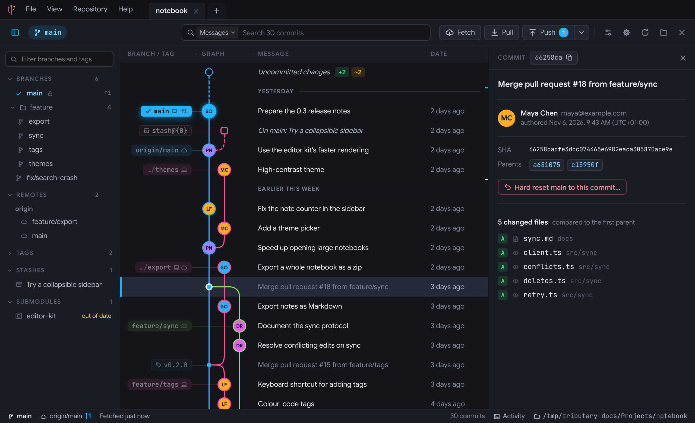

## Why Tributary

- **Made for projects full of assets.** Textures, models, sounds and Unreal or Unity files show as what they are, Git LFS downloads are fast and checked for disk space, and locks are part of the everyday flow.
- **Easy for the whole team.** Simple mode gives artists and designers just what they need (Get latest, their changes, Submit), and short guided tours show everyone around.
- **Hard to lose work.** Almost everything has Undo, your uncommitted changes are snapshotted every few minutes, and branches are backed up before they're rewritten or deleted.
- **Built for big repositories.** History is read directly with [gitoxide](https://github.com/GitoxideLabs/gitoxide), only the rows on screen are drawn, and the changes git makes run through your own git, exactly as on the command line.

## Highlights

<table>
  <tr>
    <td width="50%" valign="top">
      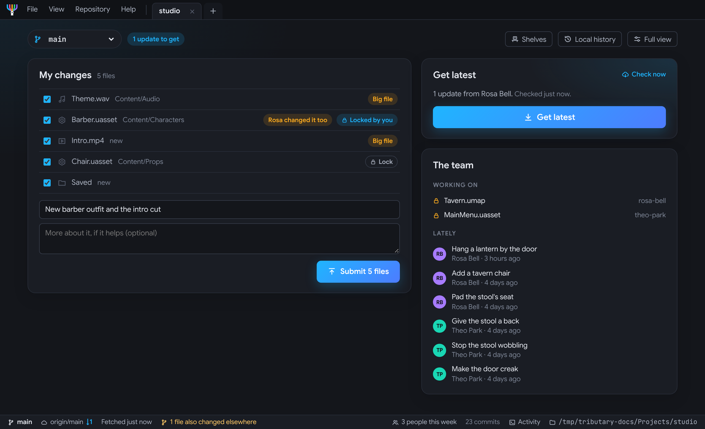<br>
      <b>Simple mode</b><br>
      Get latest, your changes with their locks, and one Submit button. No branches or graph to learn.
    </td>
    <td width="50%" valign="top">
      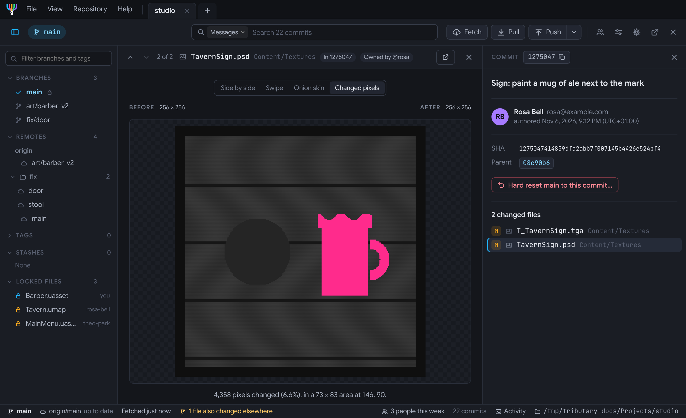<br>
      <b>See what changed in your art</b><br>
      PSD, TGA, DDS, EXR and more, Blender and Unreal thumbnails, with swipe, onion skin and changed pixels.
    </td>
  </tr>
  <tr>
    <td width="50%" valign="top">
      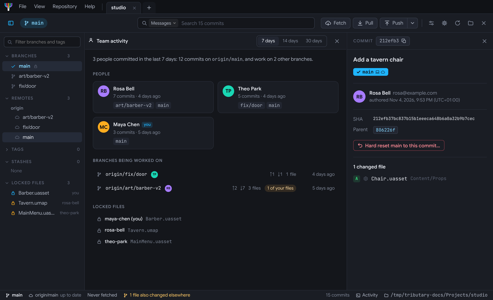<br>
      <b>Team activity</b><br>
      Who's working on what, the files changed most, and the branches in progress.
    </td>
    <td width="50%" valign="top">
      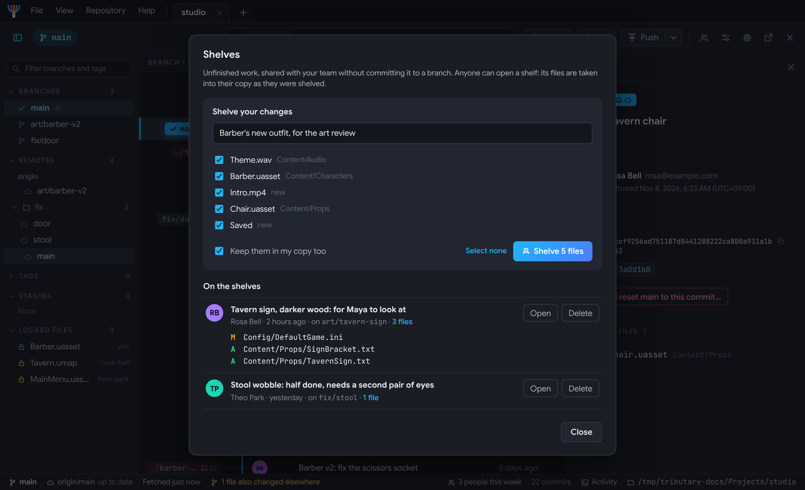<br>
      <b>Shelves</b><br>
      Share unfinished work for a review without committing it to a branch, as in Perforce.
    </td>
  </tr>
  <tr>
    <td width="50%" valign="top">
      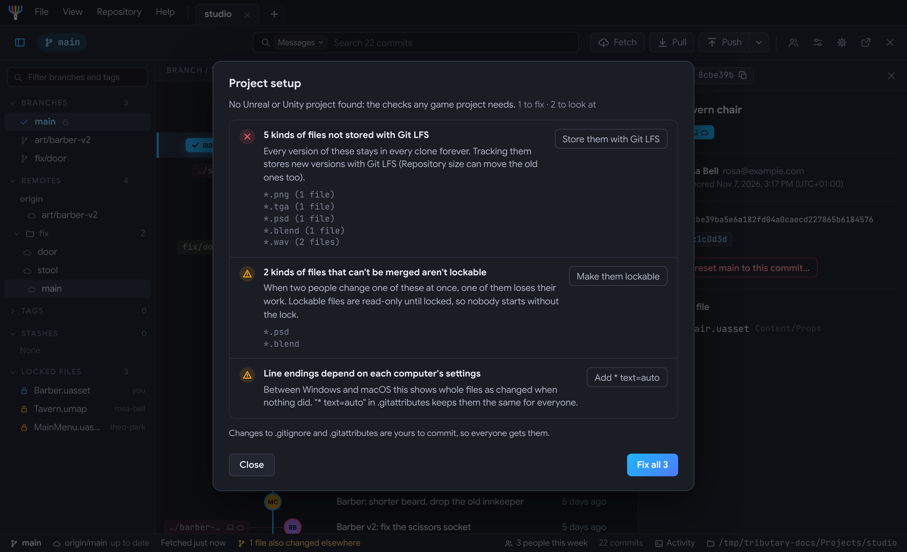<br>
      <b>Project setup check</b><br>
      Finds what's wrong with an Unreal or Unity project's git setup, and fixes it.
    </td>
    <td width="50%" valign="top">
      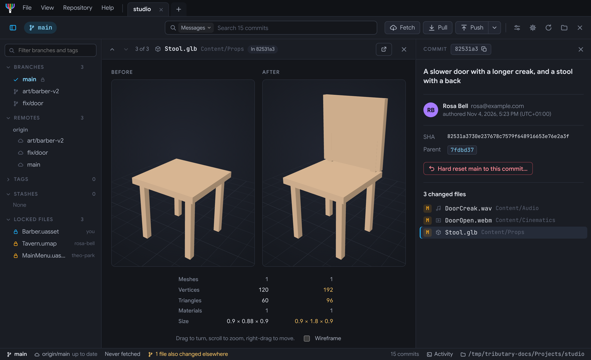<br>
      <b>3D models, sounds and video</b><br>
      Models in two views that turn together, sounds as waveforms, videos side by side.
    </td>
  </tr>
  <tr>
    <td width="50%" valign="top">
      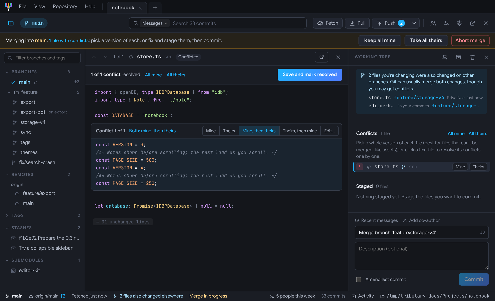<br>
      <b>Conflicts, resolved in the app</b><br>
      Mine, theirs, both or your own edit for text; a whole version for assets.
    </td>
    <td width="50%" valign="top">
      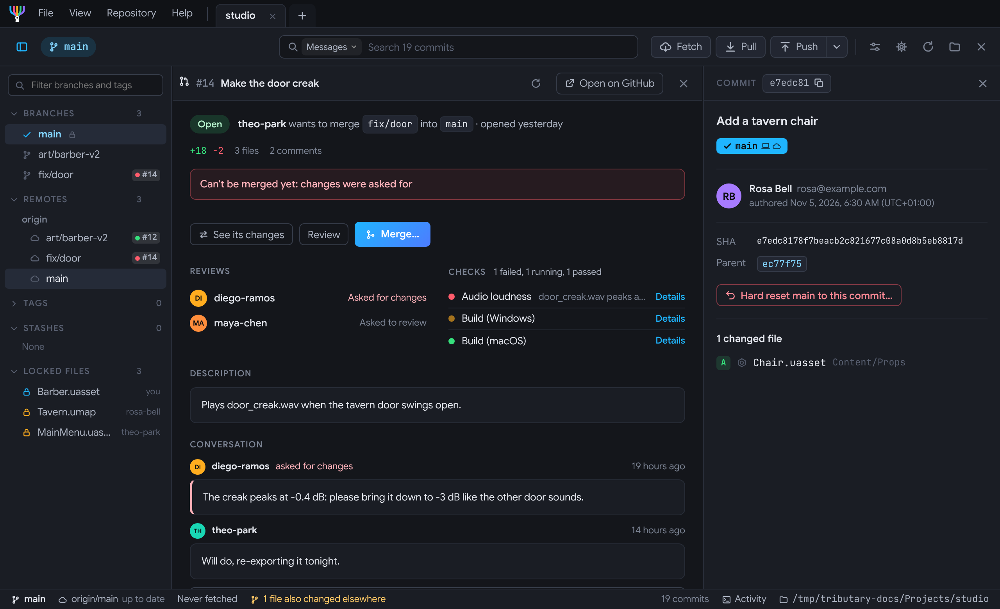<br>
      <b>Pull requests in the app</b><br>
      Reviews, checks, comments and merging, on GitHub and GitLab.
    </td>
  </tr>
  <tr>
    <td width="50%" valign="top">
      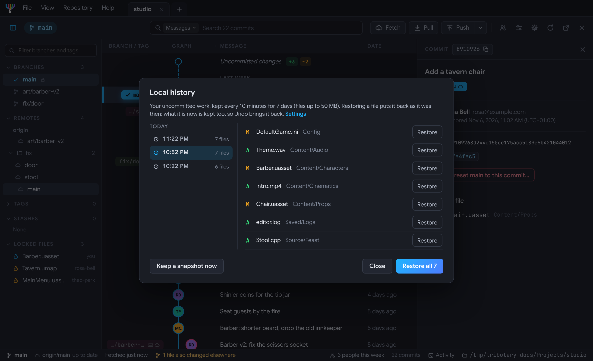<br>
      <b>Local history</b><br>
      Your uncommitted work, kept every few minutes, to put back after a crash or an overwrite.
    </td>
    <td width="50%" valign="top">
      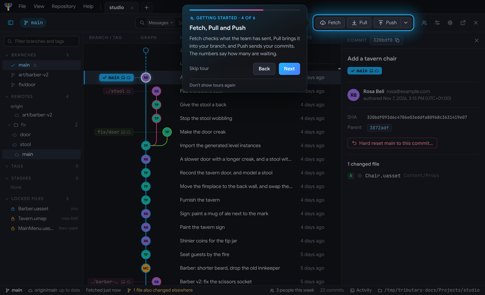<br>
      <b>Guided tours</b><br>
      Short tours that point at the real thing, offered once, and easy to turn off.
    </td>
  </tr>
</table>

## Everything it does

One line each here; the [feature guide](docs/features.md) has the details.

### History and the graph
- A colourful commit graph, with branches, remote branches, tags and stashes labelled.
- Search by message, author, branch, file (`*.psd`) or code.
- Hide, solo or highlight branches; highlight an author's commits.
- Changes made outside the app show up as they happen.
- Smooth on long histories: only the rows on screen are drawn.

→ [More about the graph](docs/features.md#the-commit-graph)

### Changes and committing
- Diffs coloured by syntax, in one column or side by side.
- Stage, unstage or discard whole files, hunks or single lines.
- The branch's Jira or Linear issue in the summary, message templates and co-authors.
- Fix up or split earlier commits; signed commits with GPG or SSH.
- Warnings before committing file names that break on Windows or macOS, and missing Unity `.meta` files.

→ [More about changes](docs/features.md#changes-line-by-line) · [committing](docs/features.md#committing)

### Branches and history
- Drag a branch onto another to merge or rebase, and see beforehand whether it would conflict.
- Interactive rebase, cherry-pick, revert and hard reset.
- Stacked branches, and what changed when a branch was force-pushed.
- Tags with release notes; patches; pruning branches that are merged or gone.

→ [More about branches](docs/features.md#branches-merging-and-rewriting-history)

### Finding out who, what and why
- Blame, going back through older versions of each line.
- File and folder history, comparing two branches or commits, and bisect.

→ [More about investigating](docs/features.md#who-changed-what-and-why)

### Pull requests, CI and issues
- Pull and merge requests in the app: open, review, comment and merge.
- CI status on every commit, and re-running failed jobs.
- GitHub, GitLab, Jira and Linear issues, with branches named after them.
- Code owners offered as reviewers when you open a pull request.

→ [More about pull requests](docs/features.md#pull-requests-and-remotes)

### Working as a team
- Git LFS locks: see who holds what, lock and unlock, and get reminders.
- A warning when a file you're changing was also changed on another branch.
- Get latest on a schedule, so a big update is waiting in the morning.

→ [More about teams](docs/features.md#working-as-a-team)

### Game projects and big files
- Fast Git LFS downloads, with file counts, time left and a disk space check.
- Unreal actors listed by name, and Unity Smart Merge for scenes and prefabs.
- Sparse checkouts, git's speed-ups, and finding what makes a repository big.

→ [More about game projects](docs/features.md#game-projects-big-files-and-git-lfs)

### Safety nets
- Undo for almost everything, and a list of your actions with Undo on each.
- Backups of branches before they're deleted or rewritten, protected branches, and recovering lost commits.

→ [More about safety nets](docs/features.md#safety-nets)

### Comfortable every day
- Tabs, worktrees and submodules; a start screen with every recent repository's state.
- A command palette and keyboard shortcuts for everything.
- Dark and light themes, your own accent and graph colours, and colour-blind safe palettes.
- Open in your editor or terminal; move your settings to another computer.
- Automatic, signed updates, and What's new after each one.

→ [More about the app](docs/features.md#tabs-repositories-and-the-start-screen) · [keyboard shortcuts](docs/features.md#keyboard-shortcuts)

## Download

Get the latest version from the [releases page](https://github.com/shikoko/tributary/releases):

- **macOS:** the `.dmg`, one app for Apple Silicon and Intel.
- **Windows:** the `-setup.exe` or `.msi` (64-bit).

Tributary updates itself after that. It needs [git](https://git-scm.com) installed (and [Git LFS](https://git-lfs.com) for repositories that use it).

The installers aren't code-signed yet, so the first launch needs one extra step:

- **macOS:** if it says the app "is damaged" or "can't be opened", move it to Applications and run `xattr -cr /Applications/Tributary.app` once.
- **Windows:** if SmartScreen warns you, choose **More info → Run anyway**.

## Build from source

You need [Node.js](https://nodejs.org) 20 or newer, [Rust](https://rustup.rs) and [Tauri's prerequisites](https://tauri.app/start/prerequisites/) for your system. Then:

```bash
npm install
```

```bash
npm run tauri dev
```

[docs/development.md](docs/development.md) covers trying the interface in a browser, the tests, building installers, releasing, and how the code is laid out.

## License

[MIT](LICENSE).

The interface uses [Google Sans](https://fonts.google.com/specimen/Google+Sans) and [JetBrains Mono](https://www.jetbrains.com/lp/mono/), both under the [SIL Open Font License 1.1](https://openfontlicense.org). 3D models are shown with [three.js](https://threejs.org) (MIT), and code is coloured with [highlight.js](https://highlightjs.org) (BSD-3-Clause).
