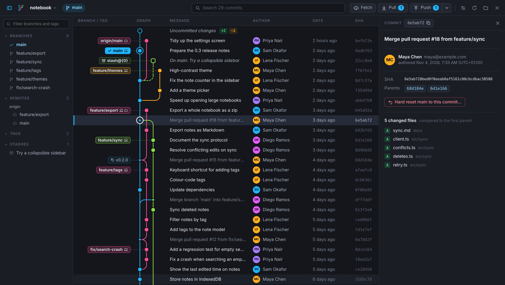

# Tributary

A fast, cross-platform git history graph viewer for macOS and Windows.



Open a repository and Tributary draws its history as a colourful commit graph, with branches and tags labelled. Click a commit to see its details. You can also clone, commit, stash, manage branches and tags, merge, rebase (interactively too), cherry-pick, fetch, pull and push. It never changes the repository unless you ask it to.

## Features

- **Commit graph:** each lane has its own colour, merges are drawn as rounded connecting lines, and local branches, remote branches and tags are labelled. Dividers like **Today**, **Last week** and **October** separate commits from different periods (you can turn them off in the View menu), and marks next to the scrollbar show where the checked-out commit, branch tips, search matches and the selection are.
- **Uncommitted changes and stashes:** a row at the top shows your uncommitted changes, and each stash appears as a small box joined to the commit it was made from.
- **Stage and commit:** click the uncommitted changes row to stage or unstage files and write a commit message. You can also amend the last commit.
- **Stashes:** stash your changes from the uncommitted changes row, and apply, pop or drop a stash by right-clicking it. When uncommitted changes stop a pull or checkout, **Stash changes and retry** stashes them, tries again, and puts them back.
- **Always up to date:** changes made in a terminal or editor show up as soon as you switch back to Tributary.
- **Commit details:** the full message, author, committer and co-authors, parents (click one to jump to it) and the list of changed files. Links, issue numbers like `#12` and commit ids in the message can be clicked.
- **Search:** find commits by message, author, branch, tag or SHA. Matches are highlighted and you can jump between them.
- **Branches:** right-click a commit to check out a branch on it, check out a remote branch (which creates a local branch that tracks it), check out the commit itself, or create a new branch there. Double-click a branch label to check it out, or right-click it to rename or delete it, locally or on the remote.
- **Branch sidebar:** every branch, remote branch, tag and stash, with a filter. Names that share a prefix, like `feature/…`, are grouped into folders, and you can pin the ones you use most to the top. Each branch shows how many commits it is ahead of (↑) and behind (↓) its upstream. Click one to jump to its commit; double-click a branch to check it out.
- **Hide or solo branches:** the eye next to a branch in the sidebar hides it (and the commits only it has) from the graph. Right-click a branch and choose **Show only…** to see just that branch and the checked-out one. Tributary remembers this for each repository; **Show all** brings everything back.
- **Merge and rebase:** drag a branch label (from the graph or the sidebar) onto another commit or branch, then choose **Merge** or **Rebase**. You can also right-click a branch or commit. Both act on the checked-out branch. If git stops because of conflicts, a bar at the top shows how many files conflict, with **Continue** (or **Commit merge**), **Skip commit** and **Abort**. The commit message is filled in for you.
- **Cherry-pick and revert:** right-click a commit to copy it onto the checked-out branch, or to add a commit that undoes it. Shift-click or <kbd>⌘</kbd>/<kbd>Ctrl</kbd>-click to select several commits and cherry-pick or revert them all at once.
- **Interactive rebase:** right-click a commit on the checked-out branch and choose **Interactive rebase** to rewrite the commits after it: drag them into a new order, reword their messages, squash or fix them up into the commit below, or drop them.
- **Prune branches:** clean up local branches whose remote branch was deleted (usually merged pull requests) and branches merged into the main branch, from the Repository menu, the broom on the sidebar's Branches heading, or the status bar when a fetch finds some. Branches with commits that aren't in the main branch are listed but left unticked, the checked-out branch and long-lived ones like main are never offered, and **Undo** puts them all back.
- **Branch safety:**
  - **Protected branches:** main, master and develop by default, plus any you protect from a branch's right-click menu (shown with a padlock). They can't be deleted, and rebasing, hard resetting or force pushing one needs its name typed first.
  - **What would be lost:** deleting a branch (here or on the remote) first lists the commits that are on no other branch, remote branch or tag, or says that nothing is lost.
  - **Restore Branch…:** whenever Tributary deletes, prunes, resets, rebases or force-pushes a branch, it keeps where the branch was for 30 days (as hidden refs under `refs/tributary/backups/`, which also keep the commits from git's garbage collection). The Repository menu lists them and puts any of them back, without overwriting anything. Deleting a branch from the remote can also be undone straight away.
- **Tags:** create a tag on any commit (annotated when you give it a message), push it, or delete it here or on the remote.
- **Highlight a branch's history or an author's commits:** <kbd>Alt</kbd>+click a branch label (or right-click it and choose **Highlight**) to fade every commit that isn't part of its history. Right-click a commit to highlight everything its author committed, or turn on **Highlight My Commits** in the View menu. Press <kbd>Esc</kbd> to stop.
- **Only this branch:** in the View menu, **Only *branch*'s own history** hides merged-in side branches and shows just the commits made on the checked-out branch, following first parents.
- **Hover previews:** rest the mouse on a commit for a moment to see its full message and changed files without opening it. You can turn this off in the View menu.
- **Command palette:** <kbd>⌘</kbd>/<kbd>Ctrl</kbd> + <kbd>K</kbd> lists the commands and branches, so you can check out, merge, highlight or run almost anything by typing a few letters. Press <kbd>?</kbd> to see all keyboard shortcuts.
- **Undo:** after a checkout, commit, merge, rebase, interactive rebase, cherry-pick, revert, hard reset, rename, new tag, or branch or tag deletion, the confirmation message has an **Undo** button.
- **Fetch, pull and push:** buttons in the toolbar, with the number of commits to pull and to push. A progress bar shows how far along they are, with a **Cancel** button, including Git LFS uploads and downloads (files, megabytes and speed). Tributary also fetches by itself every 5 minutes, so the numbers stay current (you can turn this off in the View menu). The first push of a new branch sets its upstream, and when the remote suggests opening a pull request, a **Create pull request** button takes you there. When a pull needs a merge and you haven't told git whether to merge or rebase, it merges.
- **Force push:** from the menu next to Push, after a confirmation. It uses `--force-with-lease`, so it stops if someone else pushed in the meantime.
- **Hard reset:** right-click a commit (or use the button in its details) to hard reset the checked-out branch to it. A confirmation shows exactly what will be lost first.
- **Large repositories:** the 10,000 most recent commits load at once, and a button at the end of the list loads more. Only the visible rows are drawn, so scrolling stays smooth.
- **On GitHub, GitLab and Bitbucket:** right-click a commit, branch or tag to open it on the website, or a branch to create a pull (or merge) request.
- **Status bar:** the checked-out branch and how it compares to its upstream, when the repository was last fetched (click to fetch), and the repository's folder (click to show it in Finder or Explorer).
- **Activity log:** every git command Tributary runs, with what git printed, how long it took and whether it worked. Open it from the status bar or with <kbd>⌘</kbd>/<kbd>Ctrl</kbd> + <kbd>Shift</kbd> + <kbd>L</kbd>.
- **No git install needed to browse:** history is read directly with [gitoxide](https://github.com/GitoxideLabs/gitoxide). Actions that change the repository (cloning, committing, stashing, branches, tags, merge, rebase, cherry-pick, revert, fetch, pull, push, reset) run your installed git, so they behave exactly like the command line and use the credentials you already set up for it.
- **Open, clone or create:** open a repository, clone one from its address (with progress and **Cancel**), create a new one in a folder, or drop a folder onto the window. The welcome screen lists recent repositories with the branch you were on; pin the ones you use most, or type to find one.
- **Tabs:** open several repositories at once, each in its own tab. Tributary reopens your tabs when it starts, and each tab remembers the selected commit, where you scrolled to and your unfinished commit message. The **+** button opens a new tab with the start screen: open, clone or create a repository, or pick a recent one.
- **Menu bar:** File, View, Repository and Help menus with every command and its shortcut: in the macOS menu bar, and next to the tabs on Windows.
- **Profile pictures (optional):** turn on **Profile pictures** in the View menu to show authors' Gravatar or GitHub pictures instead of initials. It is off by default, because it sends a hash of each author's email address to Gravatar (or the GitHub username, for GitHub `noreply` addresses).
- **Your layout:** drag the edges of the sidebar, the details panel and the Branch / Tag and Graph columns (double-click to reset). Right-click the column headings to show or hide Author, Date and SHA, and to show exact dates or commit dates instead of "3 hours ago". The View menu has compact rows and zoom. All of it is remembered. On macOS the toolbar sits in the title bar, next to the window buttons.

### Keyboard shortcuts

| Keys | Action |
| --- | --- |
| <kbd>⌘</kbd>/<kbd>Ctrl</kbd> + <kbd>K</kbd> | Command palette |
| <kbd>⌘</kbd>/<kbd>Ctrl</kbd> + <kbd>O</kbd> | Open a repository |
| <kbd>⌘</kbd>/<kbd>Ctrl</kbd> + <kbd>T</kbd> | New tab, with the start screen |
| <kbd>⌘</kbd>/<kbd>Ctrl</kbd> + <kbd>W</kbd> | Close the tab |
| <kbd>⌘</kbd>/<kbd>Ctrl</kbd> + <kbd>1</kbd> … <kbd>9</kbd>, <kbd>Ctrl</kbd> + <kbd>Tab</kbd> | Switch tabs |
| <kbd>⌘</kbd>/<kbd>Ctrl</kbd> + <kbd>R</kbd> or <kbd>F5</kbd> | Refresh |
| <kbd>⌘</kbd>/<kbd>Ctrl</kbd> + <kbd>F</kbd> | Search; <kbd>Enter</kbd> / <kbd>Shift</kbd>+<kbd>Enter</kbd> for the next / previous match |
| <kbd>⌘</kbd>/<kbd>Ctrl</kbd> + <kbd>B</kbd> | Show or hide the branch sidebar |
| <kbd>⌘</kbd>/<kbd>Ctrl</kbd> + <kbd>Shift</kbd> + <kbd>L</kbd> | Show or hide the activity log |
| <kbd>⌘</kbd>/<kbd>Ctrl</kbd> + <kbd>Enter</kbd> | Commit, in the commit message box |
| <kbd>⌘</kbd>/<kbd>Ctrl</kbd> + <kbd>+</kbd> / <kbd>−</kbd> / <kbd>0</kbd> | Zoom in, zoom out, actual size |
| <kbd>↑</kbd> <kbd>↓</kbd> <kbd>Page Up</kbd> <kbd>Page Down</kbd> <kbd>Home</kbd> <kbd>End</kbd> | Move through commits |
| <kbd>Shift</kbd> + click, <kbd>Shift</kbd> + <kbd>↑</kbd> <kbd>↓</kbd> | Select a range of commits |
| <kbd>⌘</kbd>/<kbd>Ctrl</kbd> + click | Add a commit to the selection, or take it out |
| <kbd>Alt</kbd> + click a branch label | Highlight the branch's history |
| <kbd>Esc</kbd> | Stop highlighting, then clear the selection, then close the details panel |
| <kbd>?</kbd> | Show the keyboard shortcuts |

## Download

The installers are built by GitHub Actions, only when you start a build: open the **Actions** tab, choose **Build**, then **Run workflow**. When it finishes, download the installers from the **Artifacts** section of the run:

- **macOS:** `.dmg` with a universal app (Apple Silicon and Intel)
- **Windows:** `.msi` and `-setup.exe` installers (64-bit)

To publish a release, type a version tag such as `v0.2.0` in the **release** box before starting the build. A draft GitHub release with the installers attached is created when it finishes. Update `version` in `src-tauri/tauri.conf.json` and `package.json` first, so the installer names match.

The builds are not code-signed yet, so the first launch needs one extra step:

- **macOS:** if macOS says the app "is damaged" or "can't be opened", move it to Applications and run `xattr -cr /Applications/Tributary.app` once.
- **Windows:** if SmartScreen shows a warning, choose **More info → Run anyway**.

## Development

Tributary is a [Tauri 2](https://tauri.app) app: a Rust backend reads the repository, and a React + TypeScript frontend draws it.

### Prerequisites

- [Node.js](https://nodejs.org) 20 or newer
- [Rust](https://rustup.rs) (stable)
- **macOS:** Xcode Command Line Tools (`xcode-select --install`)
- **Windows:** [Microsoft C++ Build Tools](https://visualstudio.microsoft.com/visual-cpp-build-tools/) with "Desktop development with C++". WebView2 comes with Windows 10 and 11.

The [Tauri prerequisites guide](https://tauri.app/start/prerequisites/) has more detail.

### Run it

```bash
npm install
```

```bash
npm run tauri dev
```

### Build installers for your platform

```bash
npm run tauri build
```

The installers end up in `src-tauri/target/release/bundle/`.

### Test

```bash
cargo test --manifest-path src-tauri/Cargo.toml
```

The integration tests create small repositories with the `git` command, so git needs to be installed to run them. The tests don't run on GitHub Actions, so run them before you build.

### Project layout

| Path | What it does |
| --- | --- |
| `src-tauri/src/repo.rs` | Reads commits, branches, tags and changed files with gix |
| `src-tauri/src/graph.rs` | Gives each commit a lane and works out the lines to draw in each row |
| `src-tauri/src/lib.rs` | The commands the frontend calls |
| `src-tauri/src/links.rs` | Turns remote addresses into web pages (GitHub, GitLab, …) |
| `src-tauri/src/actions.rs` | Runs git for everything that changes the repository, with progress and cancel |
| `src-tauri/src/lfs.rs` | Follows Git LFS's progress log during a push, pull, fetch or clone |
| `src/components/CommitList.tsx` | The commit list, which only renders the rows on screen |
| `src/components/graphPainter.ts` | Draws the graph for the visible rows on a canvas |
| `src/components/CommitDetails.tsx` | The details panel |
| `src/styles.css` | The dark theme |

The app icons are generated from `src-tauri/icons/app-icon.svg`. Tauri's own SVG renderer shows the background's gradient in visible bands, so render the SVG with Chrome first, then generate the icons from that PNG (on macOS):

```bash
"/Applications/Google Chrome.app/Contents/MacOS/Google Chrome" --headless --hide-scrollbars --window-size=1024,1024 --default-background-color=00000000 --screenshot="$TMPDIR/app-icon.png" "file://$PWD/src-tauri/icons/app-icon.svg"
```

```bash
npm run tauri icon "$TMPDIR/app-icon.png" && rm -rf src-tauri/icons/android src-tauri/icons/ios
```

The in-app logo (`Logo` in `src/components/Icons.tsx`) is the same drawing without the tile; change both together.

## License

[MIT](LICENSE)
