# Feature guide

Everything Tributary does, in detail. For a quick look, see the [README](../README.md).

## Contents

- [The commit graph](#the-commit-graph)
- [Changes, line by line](#changes-line-by-line)
- [Committing](#committing)
- [Branches, merging and rewriting history](#branches-merging-and-rewriting-history)
- [Conflicts](#conflicts)
- [Who changed what, and why](#who-changed-what-and-why)
- [Finding what broke](#finding-what-broke)
- [Pull requests and remotes](#pull-requests-and-remotes)
- [Simple mode](#simple-mode)
- [Working as a team](#working-as-a-team)
- [Game projects, big files and Git LFS](#game-projects-big-files-and-git-lfs)
- [Safety nets](#safety-nets)
- [Tabs, repositories and the start screen](#tabs-repositories-and-the-start-screen)
- [Make it yours](#make-it-yours)
- [Under the hood](#under-the-hood)
- [Keyboard shortcuts](#keyboard-shortcuts)

## The commit graph

- **Commit graph:** each lane has its own colour, merges are drawn as rounded connecting lines, and local branches, remote branches and tags are labelled. Dividers like **Today**, **Last week** and **October** separate commits from different periods (you can turn them off in the View menu), and marks next to the scrollbar show where the checked-out commit, branch tips, search matches and the selection are.
- **Uncommitted changes and stashes:** a row at the top shows your uncommitted changes, and each stash appears as a small box joined to the commit it was made from.
- **Always up to date:** changes made outside the app (saving in an editor, committing in the terminal, a pull by a script or an agent) show up as they happen: the open repository is watched, leaving out what `.gitignore` ignores, like build output.
- **Commit details:** the full message, author, committer and co-authors, parents (click one to jump to it) and the changed files.
  - Each file has an icon for its kind (picture, sound, video, 3D model, game engine asset, code, data, text, archive, font, program), as in every file list.
  - Every file is listed, however many there are, and a long list has a filter: type part of a name or folder, like `level03 instance`. In your changes, the filter also turns **Stage all** into **Stage these 12**.
  - Links, issue numbers like `#12` (or Jira and Linear keys like `FEAST-12`) and commit ids in the message can be clicked, and the issues it mentions are listed with their titles and states ([see below](#pull-requests-and-remotes)).
- **Search:** find commits by message, author, branch, tag or SHA. Matches are highlighted and you can jump between them. Switch the search box to **Files** to find the commits in any branch that changed a file whose path contains what you type (or matches a pattern like `*.psd`), or to **Code** for the commits that added or removed some exact text, like a function's name (`git log -S`). Matches further back than the loaded commits are counted, and appear as you scroll.
- **Branch sidebar:** every branch, remote branch, tag and stash, with a filter.
  - Names that share a prefix, like `feature/…`, are grouped into folders, and you can pin the ones you use most to the top.
  - Each branch shows how many commits it's ahead (↑) and behind (↓) its upstream, counted by git over the whole history; so does its label in the graph (hover it for the details).
  - Click one to jump to its commit; double-click a branch to check it out. Double-clicking a remote branch, like `origin/feature`, checks out its local branch, and fast-forwards it when it's only behind.
- **Hide or solo branches:** the eye next to a branch in the sidebar hides it (and the commits only it has) from the graph. Right-click a branch and choose **Show only…** to see just that branch and the checked-out one. Tributary remembers this for each repository; **Show all** brings everything back.
- **Highlight a branch's history or an author's commits:** <kbd>Alt</kbd>+click a branch label (or right-click it and choose **Highlight**) to fade every commit that isn't part of its history. Right-click a commit to highlight everything its author committed, or turn on **Highlight My Commits** in the View menu. Press <kbd>Esc</kbd> to stop.
- **Only this branch:** in the View menu, **Only *branch*'s own history** hides merged-in side branches and shows just the commits made on the checked-out branch, following first parents.
- **Hover previews:** rest the mouse on a commit for a moment to see its full message and changed files without opening it. You can turn this off in the View menu.
- **Large repositories:** the 10,000 most recent commits load at once, and a button at the end of the list loads more. Only the visible rows are drawn, so scrolling stays smooth.

[↑ Contents](#contents)

## Changes, line by line

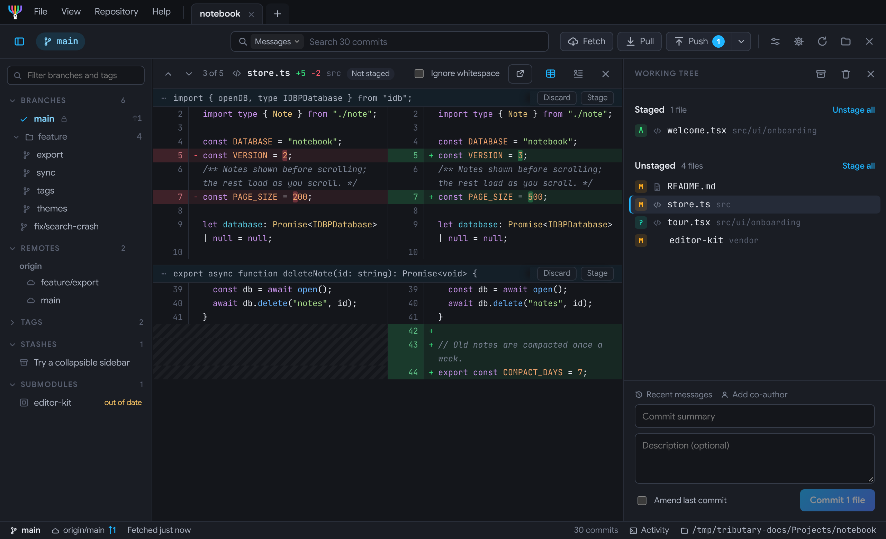

- **What changed in a file:** click a file in a commit, a stash or your changes to see its changes over the commit list.
  - Added and removed lines coloured by their syntax (TypeScript, C++, C#, Rust, Python, shaders, JSON, YAML and some twenty more), with the words that changed within a line marked, and an option to ignore whitespace.
  - The side-by-side button shows before and after in two columns, removed lines next to the lines that replaced them.
  - <kbd>[</kbd> and <kbd>]</kbd> go to the previous and next file, <kbd>Esc</kbd> closes. Your own changes update as you edit.
  - Text stored with Git LFS is compared by its real contents; pictures, sounds, videos and 3D models show as what they are ([see below](#game-projects-big-files-and-git-lfs)). Other binary files show their sizes, with a button to open them in your diff tool.
- **Diff and merge tools:** choose them in Settings, under **Diff and merge**: the tools git finds on your computer (Meld, Beyond Compare, WinMerge, P4Merge, KDiff3, …), Visual Studio Code, or a command of your own. They're git's own settings (`diff.tool`, `merge.tool`), so `git difftool` and `git mergetool` use them too. Until one is chosen, the diff view's button offers to choose one.
- **Per file:** right-click a changed file to discard its changes (with **Undo**; Tributary keeps them for 30 days), stash just that file, or for a new file, ignore it, every file like it, or its folder (added to `.gitignore`, with **Undo**).

[↑ Contents](#contents)

## Committing

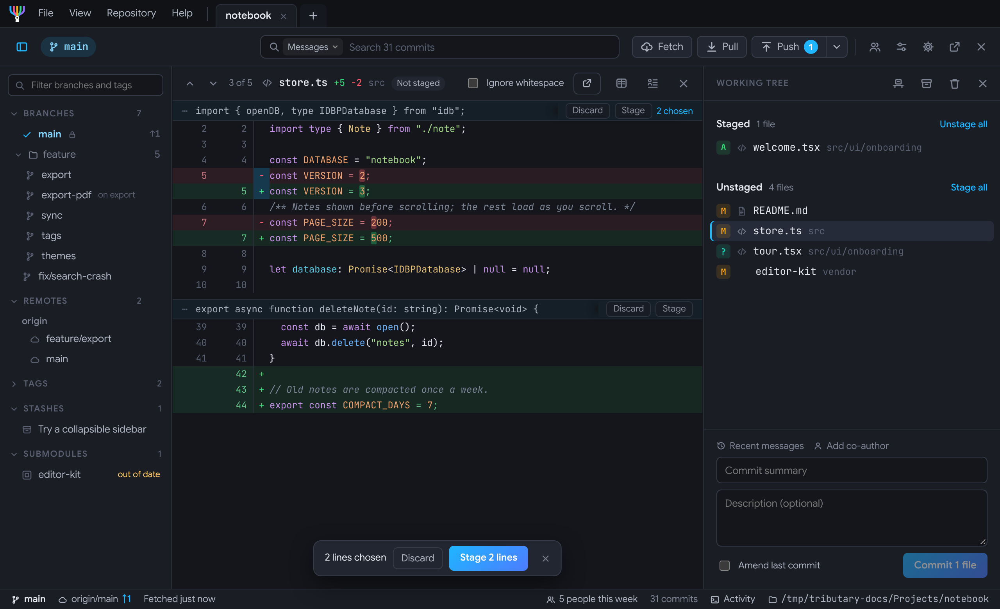

- **Stage and commit:** click the uncommitted changes row to stage or unstage files and write a commit message. You can also amend the last commit. The summary shows its length (amber past 50 characters, red past 72), **Recent messages** reuses one of yours, and **Add co-author** credits someone from the history with a `Co-authored-by:` line.
- **The issue in the summary, and message templates:** on a branch named after a Jira or Linear issue (`FEAST-23-tavern-sign`), the issue's key shows in front of the summary and goes into the commit (`FEAST-23: Add the opening hours`), unless the message mentions it already; click the key to leave it out this time. A message template, the team's `commit.template` or one written in the repository's settings (**Commits → Message template**, kept for that repository only), fills in new commit messages; lines starting with `#` are left out, as with git, and an unchanged template can't be committed by mistake.

  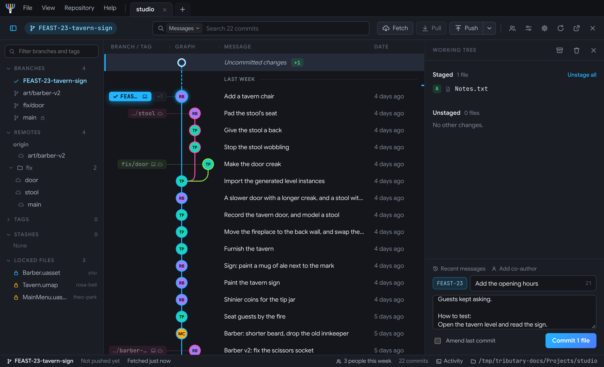

- **Stage, unstage or discard parts of a file:** in the changes of a file you're working on, each hunk (a stretch of changed lines) has **Stage** and **Discard** buttons (**Unstage** for staged changes). To pick lines instead, click their line numbers (shift-click or drag for several), then **Stage 3 lines** or **Discard** in the bar that appears; <kbd>Esc</kbd> lets go of them. Discarded lines are kept for 30 days too, so **Undo** puts them back. New, renamed and Git LFS files are staged whole, and lines can't be picked while whitespace is ignored.
- **Stashes:** stash all your changes or just the files you pick from the uncommitted changes row, and apply, pop or drop a stash by right-clicking it. When uncommitted changes stop a pull or checkout, **Stash changes and retry** stashes them, tries again, and puts them back.
- **Fix up an earlier commit:** forgot something in a commit a few back? Stage the fix, right-click that commit and choose **Fix up this commit with the staged changes**. The fix is folded into it and the commits after it are rebased on top; changes you haven't staged are put aside meanwhile and put back after. **Undo** takes the fix back out, staged again.
- **When a hook stops a commit or push:** a repository's pre-commit, commit-msg or pre-push hook that fails shows what it printed, readably, with **Commit anyway (skip hooks)** (or **Push anyway**) to go ahead without it this once (`--no-verify`).
- **Why is a file ignored?** **Why Is a File Ignored…** in Repository → Tools first explains what it does (**Don't show this again** skips that next time; Settings → General brings it back), then you choose a file, and it shows the rule that leaves it out: which `.gitignore` (or exclude file), which line, and the pattern, with **Stage it anyway** to commit it despite the rule, or **Choose another file…**.
- **Split a commit:** right-click a commit on the checked-out branch and choose **Split this commit in two…**, tick the files that go into a commit of their own right after it, and write both messages. The files end up just as they were, your uncommitted changes aren't touched, and the commits after it are made again on top; **Undo** puts it back.
- **File names that won't work everywhere:** before you commit a new file whose name breaks a teammate's checkout on another system, the changes panel says so, and committing it asks first: names that differ only in capitals from another file or folder (`Content/props` next to `Content/Props`, one folder on Windows and macOS), names Windows keeps for devices (`CON`, `aux.txt`), characters it doesn't allow (`?`, `:`), names ending in a dot or a space, and paths too long for Windows once it's cloned into a folder.
- **Signed commits:** signed commits show a **Verified** mark in their details (or why not: a bad signature, an expired or revoked key, or one that couldn't be checked), with who signed them. To sign your own, open the repository's settings and choose **Signing**: as git is set up everywhere, not at all, with a GPG key, or with an SSH key. Tributary lists the GPG keys and the SSH keys in `~/.ssh` it finds to choose from, and git signs each commit (GPG or ssh-keygen asks for the key's passphrase if it has one).

[↑ Contents](#contents)

## Branches, merging and rewriting history

- **Branches:** right-click a commit to check out a branch on it, check out a remote branch (which creates a local branch that tracks it, or brings the one you have up to date when it's only behind), check out the commit itself, or create a new branch there. Double-click a branch label to check it out, or right-click it to rename or delete it, locally or on the remote. A checkout that takes a while (a big one, or one with Git LFS files to download) shows its progress under the toolbar: files updated, and Git LFS files checked out, with megabytes and speed.
- **Merge and rebase:** drag a branch label (from the graph or the sidebar) onto another commit or branch, then choose **Merge**, **Merge with a merge commit** (never a fast-forward), **Squash** (all its changes staged as one commit, with a message listing what was squashed) or **Rebase**. You can also right-click a branch or commit. Both act on the checked-out branch. If git stops because of conflicts, a bar at the top shows how many files conflict, with **Continue** (or **Commit merge**), **Skip commit** and **Abort**. The commit message is filled in for you.
- **Know before you merge:** the **Merge** and **Rebase** items in a branch's right-click menu say whether it would go cleanly (**3 commits, no conflicts**, or **Conflicts in Barber.uasset and 1 more file**, with the files when you hover), worked out by git without merging (`git merge-tree`, git 2.38 or later). A pull request the site says conflicts lists the files that do, merged here from its commits.

  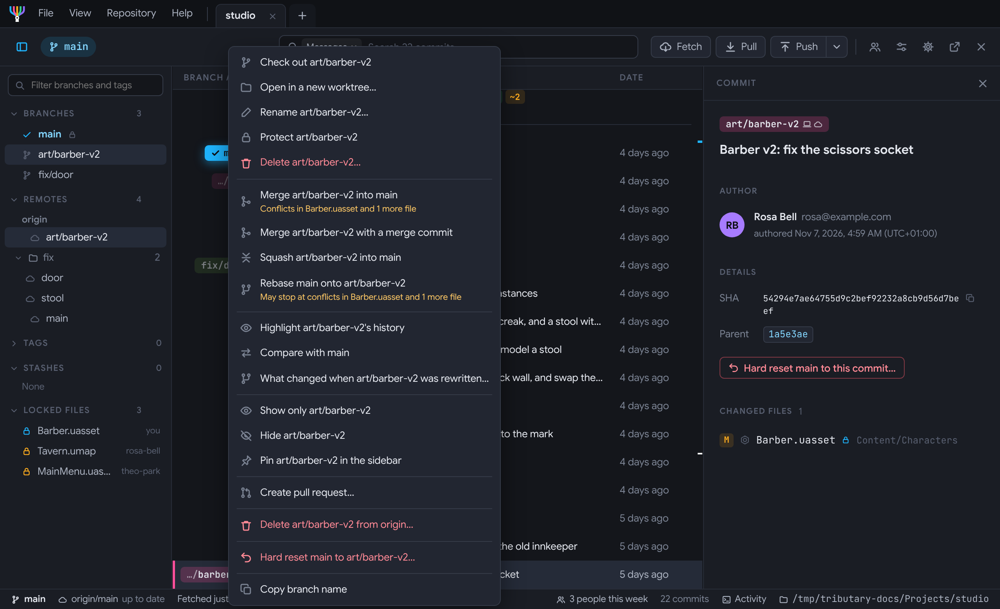

- **Stacked branches:** a branch built on another one that isn't merged yet (`feature/export-pdf` on `feature/export`) says so in the sidebar. Rebasing, rewriting, fixing up or splitting commits moves the branches built on them along (git 2.38 or later), and the message says which. When the branch below was rewritten on its own (amended, rebased or force-pushed), the one on top shows **feature/export moved**, and its menu has **Move it onto the new feature/export**.
- **What changed when a branch was force-pushed:** right-click a branch and choose **What changed when it was force-pushed…** (or **…rewritten…** for your own), or **Since the force-push** in its pull request: each commit of the version before matched with its new version (`git range-diff`), so you see only what really changed, not the commits it was moved onto: the same, changed (with how), new or dropped. Earlier rewrites can be picked too.

  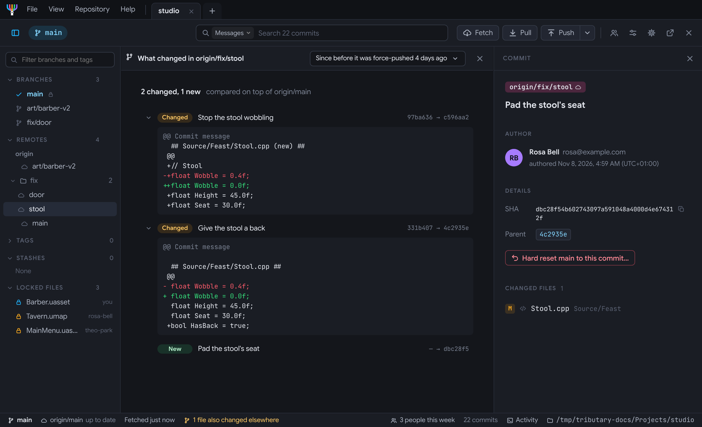

- **Cherry-pick and revert:** right-click a commit to copy it onto the checked-out branch, or to add a commit that undoes it. Shift-click or <kbd>⌘</kbd>/<kbd>Ctrl</kbd>-click to select several commits and cherry-pick or revert them all at once.
- **Interactive rebase:** right-click a commit on the checked-out branch and choose **Interactive rebase** to rewrite the commits after it: drag them into a new order, reword their messages, squash or fix them up into the commit below, or drop them.
- **Tags and release notes:** create a tag on any commit (annotated when you give it a message), push it, or delete it here or on the remote. **Release notes for v0.3.0…** in a tag's menu writes what went into it since the tag before (or one you pick): each pull request merged, by its title and number, and each commit made on the main line, the Jira or Linear issues they mention, and who contributed, as Markdown to edit, copy, or publish as the tag's release on GitHub or GitLab.
- **Hard reset:** right-click a commit (or use the button in its details) to hard reset the checked-out branch to it, or right-click a branch or tag label, like `origin/main`, to reset to where it points. A confirmation shows exactly what will be lost first.
- **Patches:** right-click a commit (or several selected) and choose **Save as a patch…** to write them as one `.patch` file, oldest first, with their authors and messages (as `git format-patch` does), or **Copy as a patch** to paste it in a message. **Apply Patch…** in the Repository menu (or dropping a `.patch`, `.diff`, `.mbox` or `.eml` file on the window) shows what's in one, its commits and files and whether it applies to your files as they are, then applies it as commits (`git am`) or as changes to commit yourself (`git apply`). One that conflicts stops like a rebase, with the bar at the top.
- **Prune branches:** clean up local branches whose remote branch was deleted (usually merged pull requests) and branches merged into the main branch, from Repository → Branches, the broom on the sidebar's Branches heading, or the status bar when a fetch finds some. Branches with commits that aren't in the main branch are listed but left unticked, the checked-out branch and long-lived ones like main are never offered, and **Undo** puts them all back.

[↑ Contents](#contents)

## Conflicts

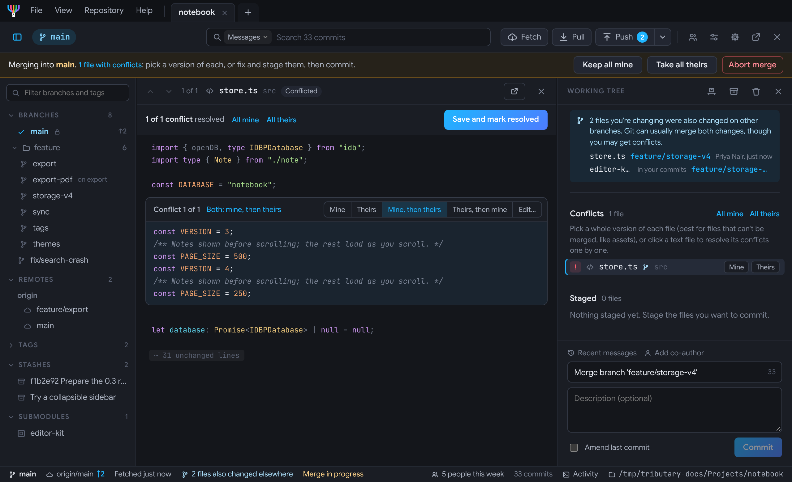

- **Resolve conflicts here:** click a conflicted text file to go through its conflicts one by one: your side and theirs next to each other (and what it was before either change, when git wrote that), with the unchanged lines around them. Keep **Mine**, **Theirs**, both in either order, or **Edit…** to write it yourself; **All mine** and **All theirs** answer every conflict at once. **Save and mark resolved** saves the file and stages it, with **Undo** to put the conflicts back.
- **Keep mine or take theirs:** files that can't be merged, like game assets, are resolved by picking a whole version. The uncommitted changes panel lists conflicted files with **Mine** and **Theirs** buttons (named after the branches when you hover), and the conflict bar has **Keep all mine** and **Take all theirs**. If one side deleted the file, picking it deletes the file. During a rebase, "mine" is still your branch (git calls it "theirs" then). **Undo** puts the conflicts back.

[↑ Contents](#contents)

## Who changed what, and why

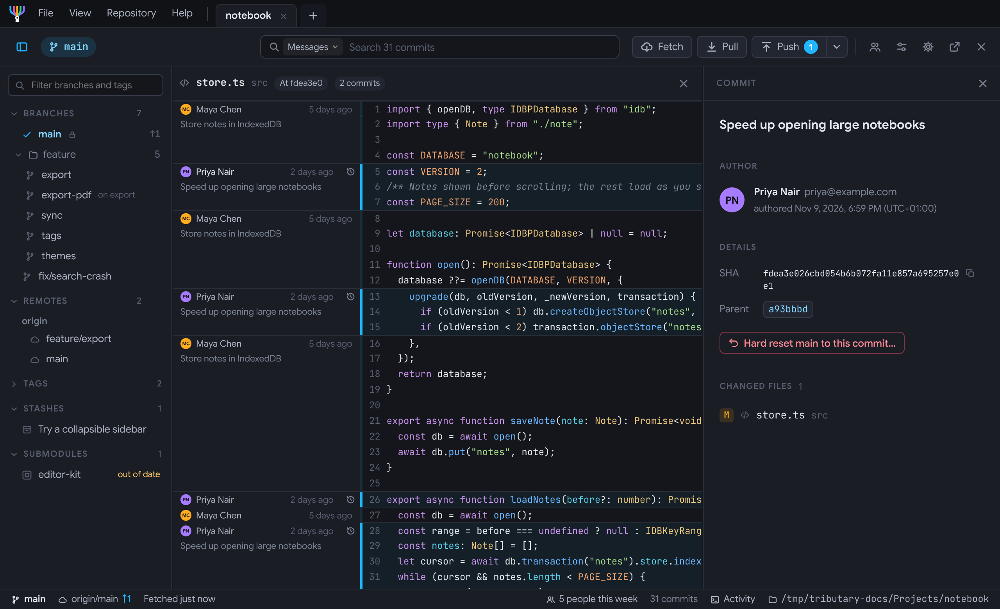

- **Who changed each line:** right-click a file (or use the button over its changes) for each line's last change: who, when and in which commit, a stretch of lines at a time, with newer changes marked brighter. In a commit it's the file as it was then; in your changes, as it is now (lines you haven't committed say so). Click an author to go to their commit. To dig further back, hover a change and click the clock next to it: the file as it was before that commit, showing who wrote those lines before (following renames). **Back** and **Forward** go between the versions you've looked at.
- **File history:** right-click a file in a commit or in your changes and choose **Show this file's history** (or its folder's). The commits that changed it stay bright, renames included, the bar at the top steps through them, and the file stands out in each commit's file list. **File History…** and **Folder History…** in the Repository menu let you pick any file or folder.
- **Compare two commits or branches:** right-click a branch label and choose **Compare with main** (the checked-out branch) to see what it has that yours doesn't, like a pull request: how many commits each has that the other doesn't, where they split, and the files that differ since then (or **Directly**, everything that's different). Select two commits (<kbd>⌘</kbd>/<kbd>Ctrl</kbd>-click) to compare them, right-click any commit to compare it with yours, or a tag to see what's changed since. Click a file to see its changes; <kbd>Esc</kbd> closes the comparison.

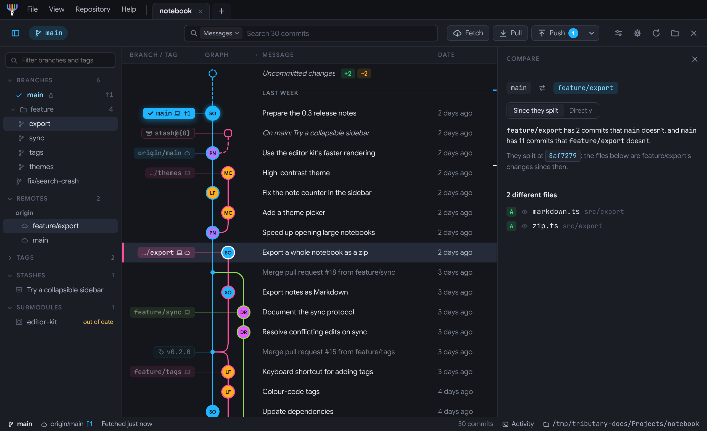

[↑ Contents](#contents)

## Finding what broke

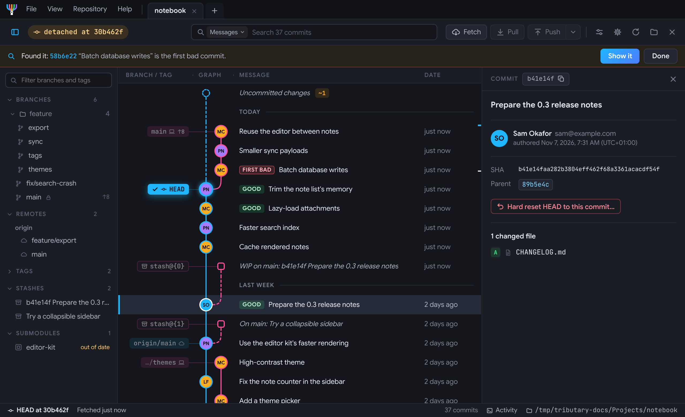

- **Find what broke (bisect):** something worked before and doesn't now? Right-click a commit where it still worked and choose **Find what broke since this commit (bisect)…**. Tributary checks out the commit halfway to the one you're on; try it, then click **Good** or **Bad** in the bar (or **Skip** if it can't be tested), and it halves what's left until it finds the first bad commit, with how many commits could still be the one along the way. Tested commits are marked good or bad in the list, and **Done** takes you back where you were.

[↑ Contents](#contents)

## Pull requests and remotes

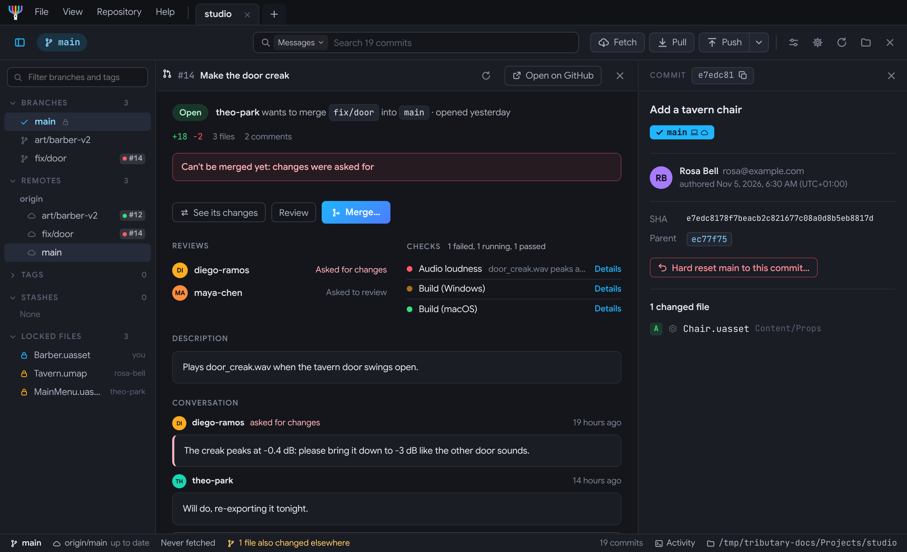

- **Pull requests in the app:** click a branch's pull request number to see it over the commit list: whether it can be merged (and if not, why: conflicts, changes asked for, failing checks), each reviewer's say, every check or pipeline job, the description, and the conversation. The checks sit on one timeline: each is a bar from when it started to when it finished, with how long it took beside it, so you can see which ran together and which took longest. A running one is a striped bar that grows, with its time counting up to the second, one waiting for a runner says **Queued**, and skipped ones come last, faded. Click a check's name to open its page. Above them, the checks that ran are drawn as tributaries: a wave for each, in its colour, braiding together into the verdict (**Passing**, **Running** or **Failing**). A running one flows, a queued one is a dotted trickle, and a failed one runs dry before the end, where a ripple keeps spreading. When a check finishes, its wave refills in its new colour, and when the last one passes, a light runs along them all and the braid glows. Hover a wave (or its row in the list below) to put that check in the spotlight: its wave glows, the others fade, its row is highlighted, and a label follows the pointer with its name, state and time. Click the wave, or tab to it and press Enter, to open that check's page in the browser. With reduced motion turned on in your system, nothing moves. Checks that are still running are followed until they finish. To open one, right-click a branch and choose **Create pull request…** (or click it in the message after pushing): the title and description start from its commits, you pick the branch it goes into and whether it's a draft, and a branch that isn't pushed yet is pushed first. Without a token for the site, it opens on the website instead. GitLab merge requests work the same way.

  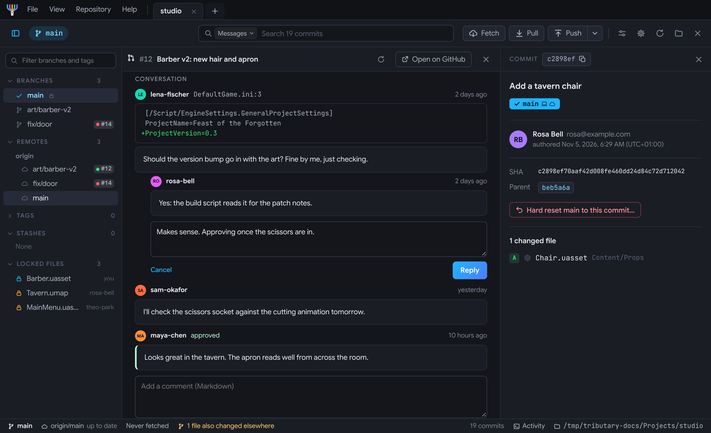

- **CI on every commit:** for a repository on GitHub or GitLab, the newest commits in the list get a dot for their checks or pipeline: green passed, red failed, amber running (followed until they finish). Failed ones are checked again every couple of minutes, since they're the ones that get run again, and a commit's dot is checked again as soon as its pull request's badge changes, so the two always agree. A commit's details list them, failures first, with links and how long each took (a running one counts up to the second; a queued one says so), and **Re-run failed** runs the failed GitHub Actions jobs (or retries the GitLab pipeline) again. On GitHub, signed in, one request asks about all of them at once.
- **Pull request controls:** an open pull request's view can mark it **Ready for review** or put it **Back to draft**, **Ask for review…** from more people or teams, and turn on **Merge when checks pass** (GitHub's auto-merge, which the repository has to allow; GitLab's merge when the pipeline succeeds), or off again.
- **Code owners:** with a `CODEOWNERS` file (in `.github/`, at the top, in `docs/` or `.gitlab/`), opening a pull request offers to ask the owners of the files it changes for a review, and a file's changes say who owns it.
- **Review, comment and merge:** a pull request's conversation shows its comments, reviews and comments on lines (with the lines they're about), each thread with its replies. Reply in a thread, add a comment, or **Review** it: approve, ask for changes, or just comment. **Merge…** merges it on the site with a merge commit, squashed or rebased (the ways the repository allows), with the commit's summary and description, and can delete its branch afterwards; it warns when the site is likely to refuse. **See its changes** compares its branch with the one it goes into, in the app.
- **News of your pull requests:** Tributary follows the pull requests you opened (and those from your branches), and tells you when someone reviews or comments on one, when its checks finish or fail, and when it's merged or closed, with **Show** to open it (and a system notification while Tributary is in the background, if you like; set in Settings next to the new-commit notices). It looks every minute, and when you come back to the window. It asks with ETags, so when nothing has changed, the answer costs nothing against GitHub's hourly limit.
- **Issues:** the repository's settings choose its issue tracker: its remote's own issues (GitHub or GitLab), Jira (its address and project keys) or Linear (its workspace and team keys), signing in to Jira and Linear with an API token, which git's credential helper keeps. Issue keys in commit messages link to their issues, commit details list the issues a commit mentions with their titles and states, and **New branch…** can start from one of the open issues assigned to you, named after it (`FEAST-23-tavern-sign-add-the-opening-hours`).

  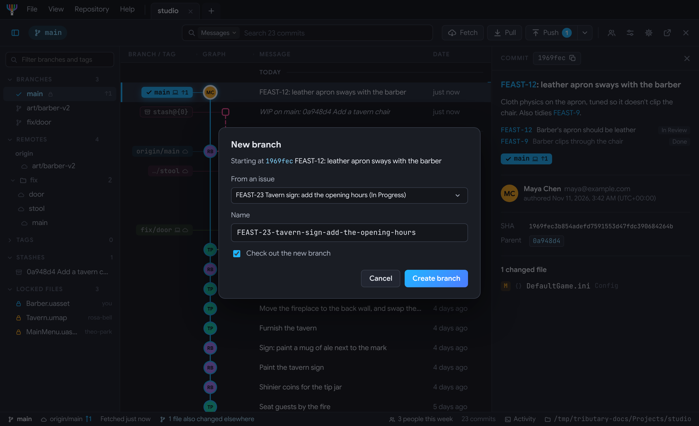
- **On GitHub, GitLab and Bitbucket:** right-click a commit, branch or tag to open it on the website. On GitHub, branches with an open pull request show its number, with a dot for its checks (green passed, red failed, amber running). On GitLab, branches with an open merge request show it the same way, like **!12**, with a dot for its latest pipeline. For private GitLab projects, sign in to your GitLab server (Settings → Accounts, or the start screen). For private repositories, sign in to GitHub in Settings with a personal access token (or in the browser, with Git Credential Manager): Tributary checks it with GitHub and hands it to git's own credential helper, so pushing uses it too. Tributary doesn't store it itself.
- **Fetch, pull and push:** buttons in the toolbar, with the number of commits to pull and to push.
  - **Progress:** a bar shows how far along they are, with **Cancel**, including Git LFS uploads and downloads (files, megabytes and speed). Hover it for the speed over time, the file it's on, the last ones done and the biggest still to come.
  - **Faster Git LFS pulls:** a pull or checkout downloads the Git LFS files it brings all together, several at a time, instead of one request per file. A second, thinner bar counts the files ("1,204 of 2,468 files"), with about how long is left.
  - **Outside the window:** the taskbar button (Windows) or Dock icon (macOS) shows the progress, a tab in the background shows it as a ring, and a long pull or push ends with a system notification if you're in another app.
  - **In the background:** every open tab is fetched every few minutes, so the numbers stay current. New commits on main or on your branch's upstream are announced with who pushed what and a **Pull** button (or a dot on another tab). Settings chooses how often, and whether to notify.
  - **Pushing:** the first push of a new branch sets its upstream, and when the remote suggests a pull request, **Create pull request** takes you there. A pull that needs a merge merges, unless you've told git to rebase.
- **Force push:** from the menu next to Push, after a confirmation. It uses `--force-with-lease`, so it stops if someone else pushed in the meantime.
- **Remotes:** add, rename and remove remotes, and change their addresses (or give pushes an address of their own), from the repository's settings or the gear on the sidebar's Remotes heading. Passwords and tokens in addresses are never shown, there or in the activity log.

[↑ Contents](#contents)

## Simple mode

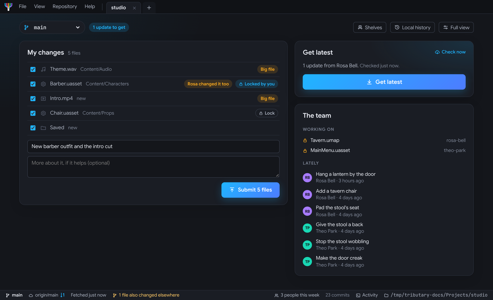

For artists, designers and anyone who'd rather not think in branches: **View → Simple Mode** (or Settings → General) swaps the graph for three cards. Each person chooses it for themselves; **Full view** switches back.

- **Get latest:** how many updates the team has sent and who they're from, **Check now**, and one button to pull them, Git LFS files and all.
- **My changes:** the files you changed, each with a tick, its lock (yours, someone else's, or **Lock** for a lockable file nobody has), and whether it's big or a teammate changed it on another branch too. Write what you changed and **Submit**: the ticked files are committed and sent, getting the team's updates first when there are any. Files someone else has locked stop it.
- **The team:** who's working on which locked files, and the latest commits.

The branch can be switched from the top, next to **Shelves** and **Local history**.

[↑ Contents](#contents)

## Working as a team

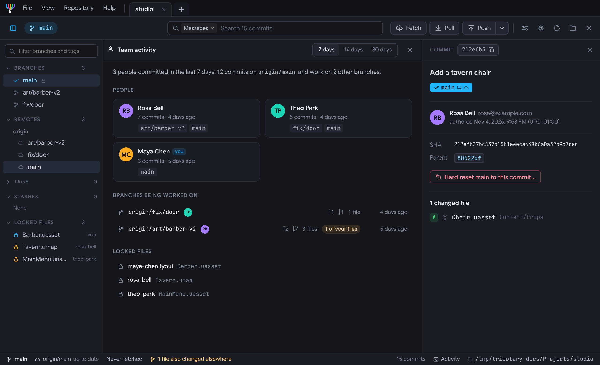

- **Team activity:** the people button in the toolbar (**View → Team Activity**, ⇧⌘T / Ctrl+Shift+T, or "6 people this week" in the status bar) sums up the last 7, 14 or 30 days. Fetch first to see your teammates' latest work.
  - **The team's days:** a graph of commits each day, with the period before behind it and how much busier or quieter this one was. Hover a day for who made its commits.
  - **What kind of work:** code, art and assets, levels, audio (each commit counts once, so thousands of generated files don't drown out the rest), and lines of code added and removed.
  - **Hotspots:** the files changed most, and by whom; files several people changed that can't be merged stand out.
  - **When the team works:** weekdays by hours. On GitHub or GitLab, also pull requests opened and merged, and how long merging takes.
  - **A card for each person:** their commits, a graph of their days, active days and streaks, lines of code, kinds of work and branches, in the graph colours from Settings. Click a person to highlight their commits.
  - **Branches being worked on:** who's on them, how far behind and ahead of main they are, how many files they change, and whether they touch files you're changing. Click one to highlight its history. Plus who holds which Git LFS locks.
- **Also changed elsewhere:** when a file you're working on (uncommitted, or changed by your branch's own commits: those not on the main branch, or not pushed yet when you're on it) was also changed on another branch in the last 30 days, the changes panel says where, by whom and in which commit, and the file gets a branch mark. Files that can't be merged, like Git LFS, lockable or binary assets, come first and stand out, since one version will have to win: better to talk to whoever changed it before spending a day on yours. The status bar shows how many; click it for the branches they're being worked on, who's working on each and when, and your files on each (click a file for that branch's change to it, or the eye to highlight the branch).
- **Shelves:** share unfinished work with the team without committing it to a branch, as Perforce does: **Repository → Shelves…** (or the shelf button over your changes, or a file's menu) shelves the files you pick with what it's for, like "Tavern sign, darker wood: for Maya to look at", and lists everyone's shelves with who made them, when, on which branch and what they change. **Open** takes a shelf's files into your copy as they were shelved (it stops, like a checkout, if it would overwrite changes of yours). Untick **Keep them in my copy too** to take them out of yours once shelved; Undo puts them back. A shelf is pushed to the remote, Git LFS files included, as a hidden ref (`refs/tributary/shelves/…`), so it needs nothing on the server besides git.

  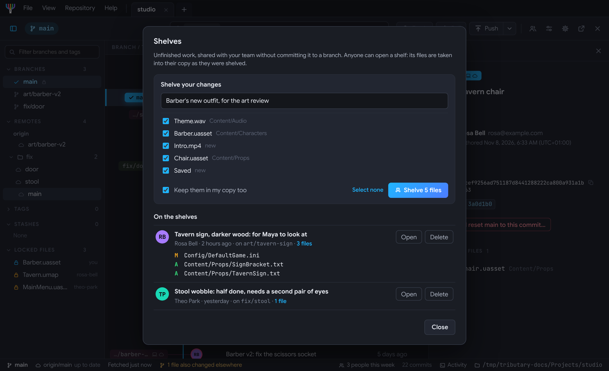

- **Fetch latest on a schedule:** Settings → Fetching → Fetch latest fetches every open tab's repository every day or on weekdays at a set time, like 07:00, and moves its branch forward when it can without merging, Git LFS files included, so a big update is waiting in the morning. It never merges: a branch with commits of its own is left for you to pull, and uncommitted changes in the way stop it before anything changes. Tributary has to be running and the computer awake (if it was asleep, it catches up within the hour). The open repository shows its progress as usual; a message says how it went, and Settings shows the last run, why any repository was skipped, and **Fetch latest now**.
- **Git LFS file locks:** in repositories that use Git LFS, the sidebar lists the locked files and who locked them, and changed files show a padlock. Lock a file from its right-click menu or with **Lock Files…** in Repository → Git LFS, unlock your own, or force-unlock someone else's after a warning. If you've changed a file someone else has locked, the changes panel says so before you try to push. If you've changed a lockable file nobody has locked, it offers to lock it for you (or, with the setting on, locks it as soon as you change it). After you push, it offers to release your locks on the files you pushed, so your teammates can work on them (files you're still changing keep theirs); in Settings you can have it release them without asking, or never.

[↑ Contents](#contents)

## Game projects, big files and Git LFS

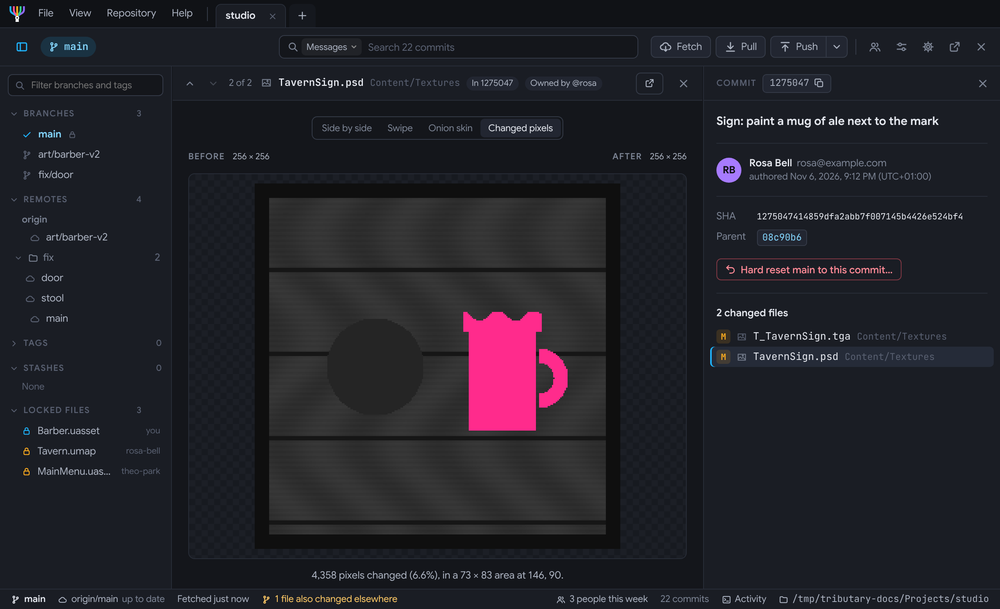

- **Pictures, sounds, videos and 3D models:** show as what they are, before and after: images side by side; sounds with players and waveforms on the same time scale; videos side by side with **Play both**; 3D models (glTF/GLB, OBJ, FBX, STL, PLY) in two views that turn together, with a wireframe option and their meshes, vertices, triangles, materials and size compared.

  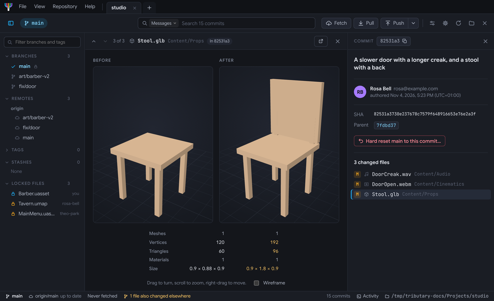

- **Textures:** Photoshop (`.psd`, `.psb`), Targa, DDS (DXT1, DXT3, DXT5), OpenEXR, TIFF and Radiance HDR files show as pictures, at most 2048 pixels a side (high dynamic range ones as they'd look on screen).
  - Blender files (`.blend`) show the preview picture Blender saves in them, and Unreal assets (`.uasset`, `.umap`) the thumbnail Unreal saves.
  - Compare two versions side by side, by **Swipe** (dragging one over the other), **Onion skin** (faded over each other), or **Changed pixels**, lit up over a greyed copy, with how many changed and where.

  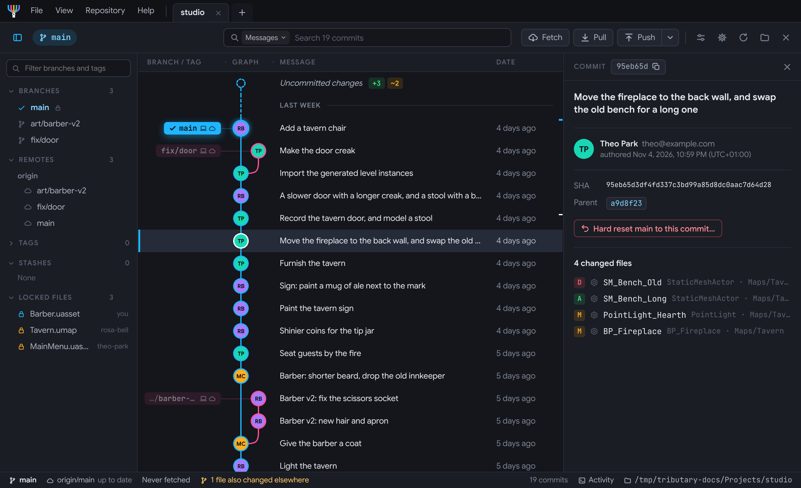

- **Unreal levels saved one actor per file:** with World Partition, each actor is a file under `__ExternalActors__` named by a hash. Tributary reads each one's name in the editor and its class from the file, and lists it as `SM_Bench_Long  StaticMeshActor · Maps/Tavern`: in commits, your changes, comparisons, the diff view and the locked files, and the file filter finds them by name. Git LFS files are read from the local copy Git LFS downloaded.
- **Unity's .meta files:** in a Unity project, before you commit, the changes panel flags new files and folders under `Assets` that have no `.meta` yet, `.meta` files whose asset is gone, and deleted assets whose `.meta` was left behind; committing them (or an asset whose new `.meta` isn't staged with it) asks first. A teammate's copy of an asset without its `.meta` gets a new id, and whatever used it loses it.
- **Unity scenes and prefabs:** in a Unity project, the repository's settings set up Unity's Smart Merge (UnityYAMLMerge, found in the editors Unity Hub installed, the project's own version first) as git's merge driver for the files Unity saves as YAML, so merges combine them by what changed in them. It's set up for this repository on this computer only. A conflicted scene or prefab also gets a **Smart Merge** button next to **Mine** and **Theirs**.
- **Check the project's setup:** **Check Project Setup…** in Repository → Tools looks at how an Unreal or Unity project (or any game project) is set up for git, with a fix for each problem:
  - folders the engine makes (`Binaries`, `Intermediate`, `Saved`, `DerivedDataCache`; `Library`, `Temp`, `Logs`, `obj`, …) that aren't ignored, or were committed
  - Git LFS not installed, or kinds of binary file it doesn't store; files over 10 MB in git itself
  - kinds of file that can't be merged but aren't lockable
  - line endings left to each computer (`* text=auto`), paths too long for Windows (`core.longpaths`), and names that differ only in capitals

  **Fix all** does every fix at once; the changes to `.gitignore` and `.gitattributes` are yours to commit.

  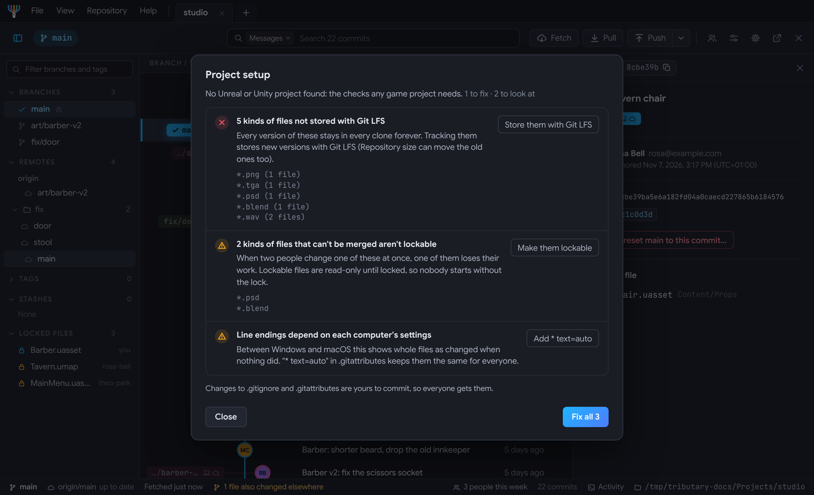

- **Big repositories:** **Folders**, in the repository's settings, changes which folders are checked out after cloning (a sparse checkout): the others leave the disk, and in a partial clone, folders you add are downloaded. **Speed** turns on git's own speed-ups, which it leaves off: its file watcher (Windows and macOS), the untracked cache, a commit graph that fetches keep up to date, and background maintenance. A big repository without any of them gets a one-time offer.
- **What makes it big:** **What Makes It Big…** in Repository → Tools shows what the history takes on disk, the biggest files in all of it (deleted ones too, since everyone who clones still downloads them), and what each folder and kind of file costs. Kinds of big file move into Git LFS from now on, or by rewriting history (`git lfs migrate`): the branch's commits that aren't pushed yet, or every branch's whole history (each backed up first, then to force-push).
- **Room on the disk:** before a pull, a branch switch or **Download them** fetches Git LFS files, Tributary adds up what they'll take (twice their size: Git LFS's copy and the checked-out file) and stops with how much is needed and free when the disk is too full, instead of failing halfway. **Download anyway** goes ahead regardless.
- **Big files and Git LFS:** the changes panel warns about big files (10 MB by default, set in Settings) that aren't stored with Git LFS, with a **Track \*.ext with LFS** button that sets up LFS and moves staged files into it. Committing a big file outside LFS asks first. **Clean Up Git LFS Files…** (Repository menu, or Settings, which shows the space they take) deletes local copies that aren't needed any more.
- **Git LFS files that weren't downloaded:** when files stored with Git LFS are still the small pointer files that stand in for them (after a clone without them, say), a bar says how many and offers **Download them**, with progress. It also says when Git LFS isn't installed (**Get Git LFS**) or git isn't set up to use it (**Set up Git LFS**). Files left out of a sparse checkout don't count.

[↑ Contents](#contents)

## Safety nets

- **Undo:** after a checkout, commit, merge, rebase, interactive rebase, split, cherry-pick, revert, hard reset, rename, new tag, or branch or tag deletion, the confirmation message has an **Undo** button.
- **Local history:** every 10 minutes (Settings → Local history: how often, the biggest file to keep, how many days), the files you've changed but not committed are kept as a snapshot, unless nothing changed since the last one. **Repository → Local History…** (or a file's menu, for just that file) lists them by day and time, with each one's files, and puts any of them back as they were then, or all of a snapshot's; what they were just before is kept too, so **Undo** brings it back.

  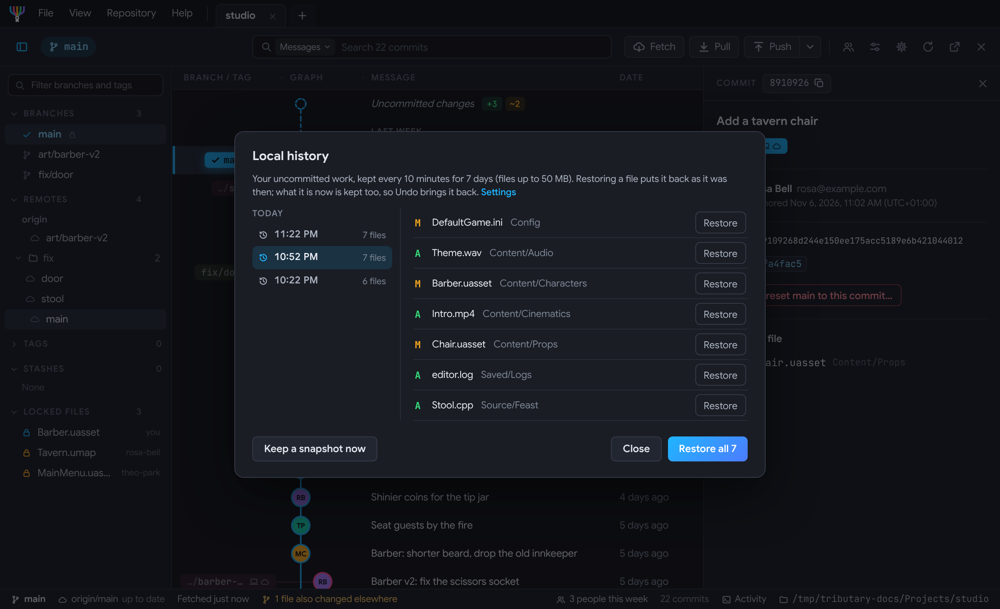

- **Your actions:** **Activity → Your actions** lists what you did in a repository (the last 50 things), each with **Undo** for as long as it's still safe: as long as the branch is where that action left it, so undoing it can't throw away what came after. When it isn't, it says why (`You've switched to main since`). They're kept when Tributary closes.

  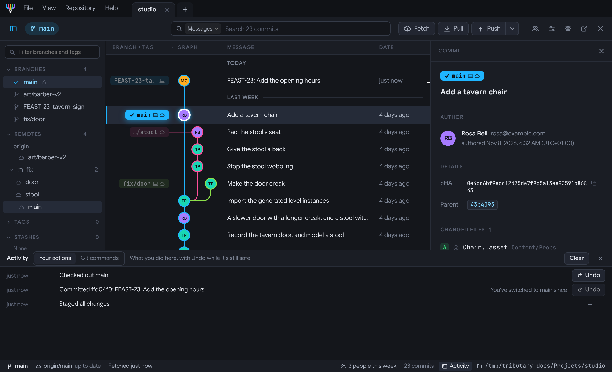

- **Branch safety:**
  - **Protected branches:** main, master and develop by default, plus any you protect from a branch's right-click menu (shown with a padlock). They can't be deleted, and rebasing, hard resetting or force pushing one needs its name typed first.
  - **What would be lost:** deleting a branch (here or on the remote) first lists the commits that are on no other branch, remote branch or tag, or says that nothing is lost.
  - **Recover Commits…** (Repository → History): git's reflog, everything that moved HEAD here (commits, checkouts, resets, rebases), newest first. Commits that are on no branch any more, say after a reset in the terminal, can get a branch again.
  - **Restore Branch…** (Repository → Branches): whenever Tributary deletes, prunes, resets, rebases, splits or force-pushes a branch (or moves the branches stacked on it), it keeps where the branch was for 30 days (as hidden refs under `refs/tributary/backups/`, which also keep the commits from git's garbage collection). The Repository menu lists them and puts any of them back, without overwriting anything. Deleting a branch from the remote can also be undone straight away.

[↑ Contents](#contents)

## Tabs, repositories and the start screen

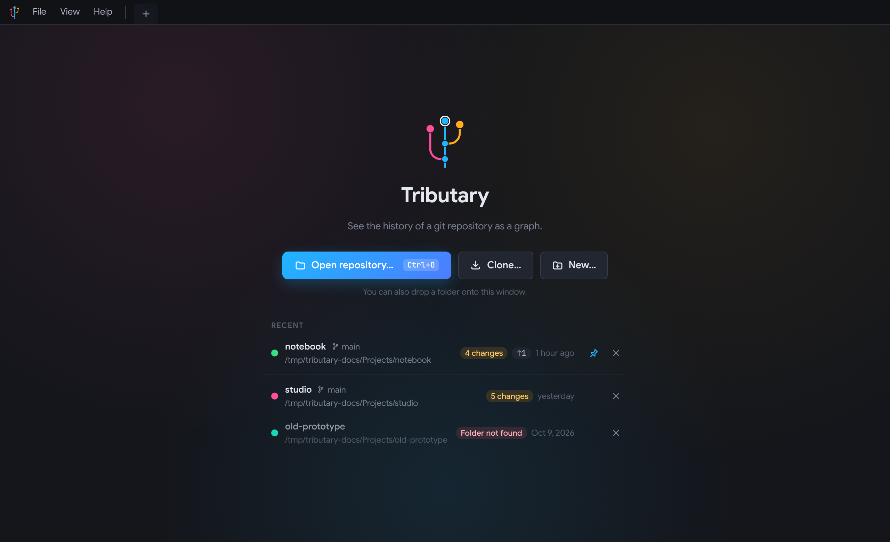

- **When git isn't installed:** the start screen says so first, and a bar says it over an open repository, with the way to get it: on a Mac, **Install the Command Line Tools** (Apple's own installer) or Homebrew; on Windows, **Get Git for Windows**; on Linux, the package manager. **Check again** looks for it, and so does coming back to the window. A git older than 2.38 gets a note, since checking a merge before doing it needs 2.38. Tributary finds git once and remembers it, and on a Mac without the Command Line Tools it never runs Apple's placeholder git (which would open their installer by itself).
- **Your accounts:** the start screen shows who you're signed in as on GitHub and GitLab (gitlab.com or your company's server), from the tokens git already keeps, with a chip each to sign in, sign in as someone else, or sign out (which makes git forget the token too). Settings → Accounts does the same. Signing in works in the browser with Git Credential Manager, or with a personal access token, which Tributary checks and hands to git's credential helper.
- **Open, clone or create:** open a repository, clone one of your repositories on GitHub or GitLab (picked from a list with a search, newest first) or from its address (with progress and **Cancel**), create a new one in a folder, or drop a folder onto the window. For big repositories, the clone dialog can leave Git LFS files to download later, check out only some folders (the contents of the rest aren't downloaded), or download only recent history. The welcome screen lists recent repositories with where each stands now: its branch, uncommitted changes and conflicts, commits to push and pull, or that its folder is gone. Pin the ones you use most, or type to find one.
- **Tabs:** open several repositories at once, each in its own tab. Tributary reopens your tabs when it starts, and each tab remembers the selected commit, where you scrolled to and your unfinished commit message. The **+** button opens a new tab with the start screen: open, clone or create a repository, or pick a recent one.
- **Worktrees:** work on two branches at once, each in its own folder. Right-click a branch and choose **Open in a new worktree…** (or a commit, to start a new branch there, or use Repository → Branches → New Worktree…), and it opens in a new tab. The sidebar's **Worktrees** section lists them: click one to see its commit, double-click to open it, or right-click to show it in Finder or Explorer, copy its path or remove it (Tributary asks before throwing away uncommitted changes). A branch that's checked out in another worktree offers to open that one instead.
- **Submodules:** the sidebar lists them and marks those that need something: **out of date** (a checkout or pull changed the commit recorded for it), **not set up**, **new commits** (to record with a commit) or **changed**.
  - Click one to open it in a new tab, update it to the recorded commit, stage it, or copy its path or address.
  - After a checkout or pull leaves submodules behind, a bar offers to update them (or, set in Settings, they're updated without asking).
  - A submodule at a new commit shows among your changes, with the commits it moved by. Cloning clones submodules too, unless you untick it.
- **Repository settings:** each repository has its own window (from its tab's right-click menu, **Repository Settings…** in the Repository menu, or the command palette):
  - the name and email you commit with there (a work address, say), and how its commits are signed
  - its remotes, its issue tracker, its protected branches and its commit message template
  - which folders are checked out, git's speed-ups, and Unity's Smart Merge (in a Unity project)
  - Git LFS: which files it stores (patterns like `*.psd`; a repository without Git LFS is offered the kinds of big files it has), the space they take, and which folders' files to download (all, only some, or all but some; git-lfs's own `lfs.fetchinclude` and `lfs.fetchexclude`)

  The tab's menu can also show the folder, copy its path, and close the tab or the others.
- **Menu bar:** File, View, Repository and Help menus with every command and its shortcut: in the macOS menu bar, and next to the tabs on Windows. On Windows the tab bar is the title bar, with the minimize, maximize and close buttons at its right.
- **Status bar:** the checked-out branch and how it compares to its upstream, when the repository was last fetched (click to fetch), and the repository's folder (click to show it in Finder or Explorer).
- **Activity log:** what you did (**Your actions**, with Undo) and every git command Tributary runs (**Git commands**), with what git printed, how long it took and whether it worked. Open it from the status bar or with <kbd>⌘</kbd>/<kbd>Ctrl</kbd> + <kbd>Shift</kbd> + <kbd>L</kbd>.
- **Tours:** short guided tours that point at the real thing: the window dims but for the part being explained, with a card beside it (**Back** and **Next**, or the arrow keys; **Skip tour**, or Esc). Getting started (the graph, your changes, Fetch, Pull and Push, the sidebar, the command palette) runs the first time someone new opens a repository. The others (working with a team, big files and Git LFS, safety nets, Simple mode) are offered once each, in a small card in the corner, when you first come across what they're about; **Help → Tours** has them all, any time. **Don't show tours again**, on every card, stops the offers; Help → Tours or Settings → General turns them back on.

  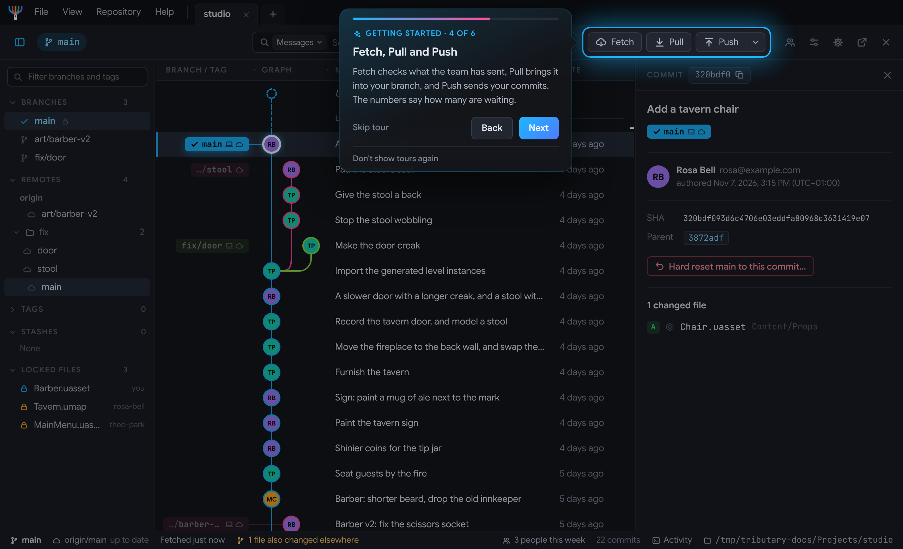

- **What's new:** after an update, Tributary shows what's new in the version you got (and the ones you skipped), one thing at a time; it's in the Help menu, to see again.
- **Command palette:** <kbd>⌘</kbd>/<kbd>Ctrl</kbd> + <kbd>K</kbd> lists the commands and branches, so you can check out, merge, highlight or run almost anything by typing a few letters. Press <kbd>?</kbd> to see all keyboard shortcuts.

[↑ Contents](#contents)

## Make it yours

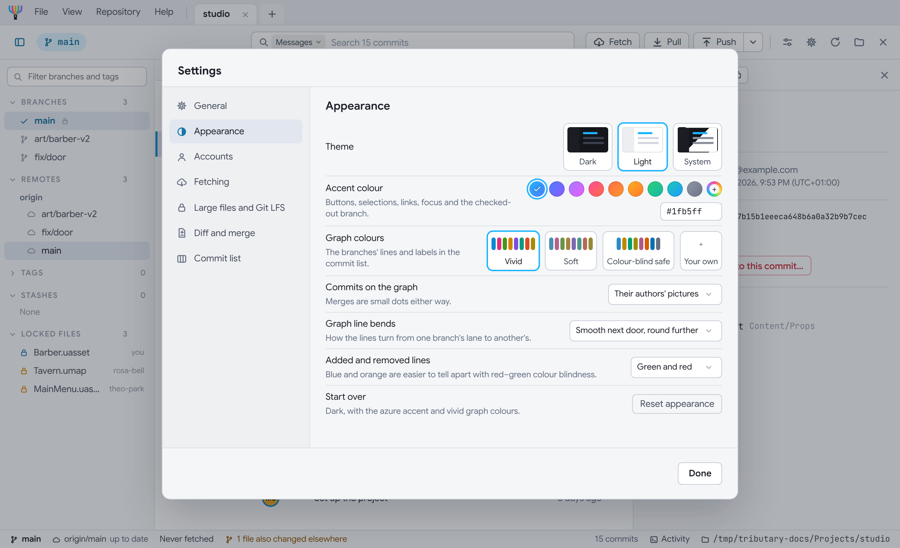

- **Appearance:**
  - **Theme:** dark, light, or the same as your system (switching when it does). The app's icon follows it, in the Dock or on the taskbar.
  - **Accent colour:** for buttons, selections, links and the checked-out branch: one of nine, or any colour (picker or a hex code like `#e8702a`). Text on it is darkened or lightened until it's easy to read; notes and warnings keep their own colours.
  - **Graph** (inside Appearance) has the graph's colours, its commits and its line bends.
  - **Graph colours:** vivid, soft, colour-blind safe (Okabe–Ito), or your own (start from any of them, then change, add or remove colours).
  - **Commits on the graph:** as their authors' pictures or initials, ringed in their branch's colour, or as dots. Lines between lanes bend smoothly (the default), or round, tight or sweeping everywhere.
  - **Diff colours:** green and red, or blue and orange, which are easier to tell apart with red–green colour blindness.
- **Settings:** <kbd>⌘</kbd>/<kbd>Ctrl</kbd> + <kbd>,</kbd> opens the app's settings, grouped in a list on the left: general (submodules, notices, tours), appearance (with the graph and the commit list inside it, joined to it by a line), accounts (your GitHub and GitLab sign-ins), fetching (and fetching the latest on a schedule), local history, large files and Git LFS, diff and merge tools, and, set apart at the end, export and import. A section inside another shows the way there above its settings, like **Appearance › Graph**; click **Appearance** to go back up.
- **Your layout:** drag the edges of the sidebar, the details panel and the Branch / Tag and Graph columns (double-click to reset). The graph widens by itself to fit the branches on screen; a width you drag it to is the least it gets. Right-click the column headings to show or hide Author, Date and SHA, and to show exact dates or commit dates instead of "3 hours ago". The View menu has compact rows and zoom. All of it is remembered. On macOS the toolbar sits in the title bar, next to the window buttons.
- **Profile pictures:** authors' pictures instead of initials, on at first; turn off **Profile pictures** in Settings → Appearance → Commit list (or the View menu) for initials only.
  - GitHub or GitLab is asked which account each author's email belongs to; otherwise, Gravatar.
  - It's off by default, because it sends authors' email addresses to GitHub or GitLab (which host the repository anyway) and a hash of them to Gravatar.
  - Pictures are kept on this computer for a week, in files named by a hash of each address, not the address. Turning them off deletes them.
- **Open in your editor or terminal:** the toolbar's **Open** button (and Repository → Open) opens the repository on GitHub or GitLab, in Finder or Explorer, or in your editor or terminal, or copies its folder's path. A changed file's menu opens the file, in the editor and terminal chosen in Settings (or the first found): Visual Studio Code, Cursor, Visual Studio, Rider, Zed, Sublime Text, IntelliJ IDEA or Fleet; Terminal, iTerm, Warp, Ghostty, Windows Terminal, PowerShell, Git Bash or the Command Prompt, or Linux's usual terminals.
- **Export and import your settings:** Settings → Export and import (at the end of the list) exports every setting and imports it on another computer: appearance (theme, accent, graph colours and the rest), columns, notices, and each repository's pinned, hidden and protected branches (matched to the repository with the same folder name there). To a file, or to a git repository of your own: **Export to a repository…** commits them there as `tributary-settings.json` and pushes them with your git and its sign-in, and **Import from a repository…** on any computer needs just the link (it's remembered). Passwords and tokens aren't in them: git's credential helper keeps those.
- **Keyboard and accessibility:** menus, tabs and the sidebar work with the arrow keys, dialogs keep the keyboard inside them and give it back when they close, every button has a name for screen readers, and animations (the side panels sliding open and closed, the progress bar sliding down, windows and menus fading in) stop when your system asks for reduced motion.

[↑ Contents](#contents)

## Under the hood

- **No git install needed to browse:** history is read directly with [gitoxide](https://github.com/GitoxideLabs/gitoxide). Actions that change the repository (cloning, committing, stashing, branches, tags, merge, rebase, cherry-pick, revert, fetch, pull, push, reset) run your installed git, so they behave exactly like the command line and use the credentials you already set up for it.
- **Automatic updates:** Tributary checks its GitHub releases now and then and downloads a new version in the background, then a **Restart to update** button appears in the tab bar. Nothing is interrupted: **Restart now** waits until no git command is running in any tab (a push, a pull, a clone…), and if you never restart, it installs when you quit, so the next start is the new version. Commit messages you're writing are kept across the restart. Updates are signed, and installed only when the signature matches. **Help → About Tributary** (on macOS, in the Tributary menu) shows the version you have and checks for a newer one as it opens, with **Check again**, the switch for checking automatically, and What's New (the command palette finds it by "update" too).
- **Reporting a problem:** **Copy Diagnostics…** in the Help menu shows Tributary's version, your system, which git and Git LFS it uses, how the open repository is set up and the last git commands that failed there, so you can read it before you copy it into a report. Passwords and tokens in remote addresses are left out.

[↑ Contents](#contents)

## Keyboard shortcuts

| Keys | Action |
| --- | --- |
| <kbd>⌘</kbd>/<kbd>Ctrl</kbd> + <kbd>K</kbd> | Command palette |
| <kbd>⌘</kbd>/<kbd>Ctrl</kbd> + <kbd>O</kbd> | Open a repository |
| <kbd>⌘</kbd>/<kbd>Ctrl</kbd> + <kbd>,</kbd> | Settings |
| <kbd>⌘</kbd>/<kbd>Ctrl</kbd> + <kbd>T</kbd> | New tab, with the start screen |
| <kbd>⌘</kbd>/<kbd>Ctrl</kbd> + <kbd>W</kbd> | Close the tab |
| <kbd>⌘</kbd>/<kbd>Ctrl</kbd> + <kbd>1</kbd> … <kbd>9</kbd>, <kbd>Ctrl</kbd> + <kbd>Tab</kbd> | Switch tabs |
| <kbd>⌘</kbd>/<kbd>Ctrl</kbd> + <kbd>R</kbd> or <kbd>F5</kbd> | Refresh |
| <kbd>⌘</kbd>/<kbd>Ctrl</kbd> + <kbd>F</kbd> | Search; <kbd>Enter</kbd> / <kbd>Shift</kbd>+<kbd>Enter</kbd> for the next / previous match |
| <kbd>⌘</kbd>/<kbd>Ctrl</kbd> + <kbd>B</kbd> | Show or hide the branch sidebar |
| <kbd>⌘</kbd>/<kbd>Ctrl</kbd> + <kbd>Shift</kbd> + <kbd>L</kbd> | Show or hide the activity log |
| <kbd>⌘</kbd>/<kbd>Ctrl</kbd> + <kbd>Enter</kbd> | Commit, in the commit message box |
| <kbd>⌘</kbd>/<kbd>Ctrl</kbd> + <kbd>+</kbd> / <kbd>−</kbd> / <kbd>0</kbd> | Zoom in, zoom out, actual size |
| <kbd>↑</kbd> <kbd>↓</kbd> <kbd>Page Up</kbd> <kbd>Page Down</kbd> <kbd>Home</kbd> <kbd>End</kbd> | Move through commits |
| <kbd>Shift</kbd> + click, <kbd>Shift</kbd> + <kbd>↑</kbd> <kbd>↓</kbd> | Select a range of commits |
| <kbd>⌘</kbd>/<kbd>Ctrl</kbd> + click | Add a commit to the selection, or take it out |
| <kbd>Alt</kbd> + click a branch label | Highlight the branch's history |
| Click a changed file, or <kbd>Enter</kbd> on it | Show its changes; <kbd>[</kbd> <kbd>]</kbd> for the previous and next file, <kbd>Esc</kbd> to close |
| <kbd>Esc</kbd> | Stop highlighting, then clear the selection, then close the details panel |
| <kbd>?</kbd> | Show the keyboard shortcuts |
| <kbd>F10</kbd> (Windows and Linux) | Open the menu bar; <kbd>←</kbd> <kbd>→</kbd> move between its menus |
| <kbd>↑</kbd> <kbd>↓</kbd> <kbd>Home</kbd> <kbd>End</kbd>, or a letter | Move through a menu; <kbd>Enter</kbd> picks, <kbd>Esc</kbd> closes |
| <kbd>←</kbd> <kbd>→</kbd> on a tab | Move between tabs; <kbd>Enter</kbd> switches, <kbd>Delete</kbd> closes |
| <kbd>↑</kbd> <kbd>↓</kbd> in the sidebar | Move between branches, tags and stashes; <kbd>←</kbd> <kbd>→</kbd> fold and unfold folders |

[↑ Contents](#contents)
