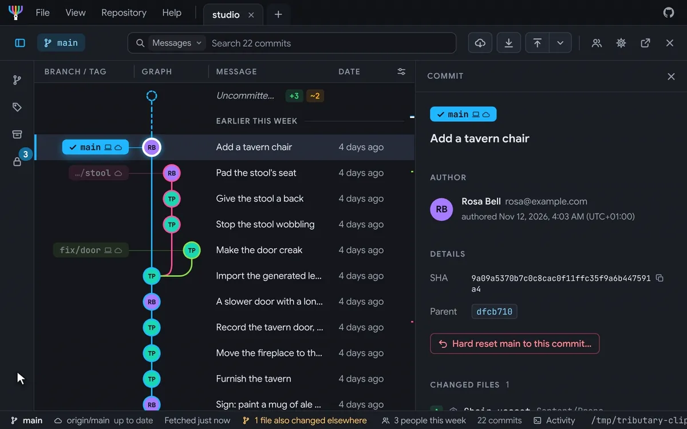

In a narrow window, the sidebar folds into a strip of icons and gives the commit list more room.

## New

- **The sidebar as a strip in narrow windows:** when the window is narrower than 1100 pixels, the sidebar becomes a thin strip of icons, one for each section: Pinned, Branches, Tags, Stashes, Worktrees, Submodules and Locked files. The commit list gets the room back. Click an icon to open the whole sidebar over the list at that section. Press Esc, click outside it or click the icon again to close it. Stashes and Locked files show how many there are on their icons. Make the window wider and the full sidebar comes back.

  

## Better

- **A pull request's checks are summed up in one place:** beside the river of checks, the title names what needs your attention, like "Audio loudness failed", or the checks still running, or, once they've all passed, how long they took. The counts are underneath, like "1 of 6 checks failed, 2 still running, 1 skipped". **Open**, which shows each run as a graph, is now at the end of the Checks heading.
- **Everything fits the smallest window** (900 by 560 pixels): About, the View panel and long menus, like the View menu, scroll when they're taller than the window, instead of running off its edge.
- **What's New for 0.9.0 is easier to read:** it's written in plainer words, and its recordings no longer jump when they start again.

## Fixes

- **A branch's line in the graph no longer stays lit** after the sidebar closes or folds into the strip while the pointer is on that branch.

<!-- release page only: the update window stops here -->

## Installing

- **macOS:** the `.dmg`, one app for Apple Silicon and Intel. Open it and drag Tributary to Applications.
- **Windows:** the `_x64-setup.exe`, or the `_arm64-setup.exe` for Windows on ARM (like a Snapdragon laptop). Agree to the terms and click Install, or choose **Custom install** to install it for everyone on the PC or in another folder.
- **Linux:** the `_amd64.AppImage`, or the `_aarch64.AppImage` for 64-bit ARM (like a Raspberry Pi 4 or 5 with a 64-bit system). Make it executable (`chmod +x Tributary_*.AppImage`, or in the file's Properties) and open it. It runs on most distributions from 2022 on, like Ubuntu 22.04 and newer. It's less tested than the Mac and Windows versions: reports and fixes are welcome.

Tributary needs [git](https://git-scm.com), and [Git LFS](https://git-lfs.com) for repositories that use it. After this, it updates itself.

The installers aren't code-signed yet, so the first launch on a Mac or Windows needs one extra step:

- **macOS, "Tributary Not Opened":** click **Done**, then open **System Settings → Privacy & Security**, scroll down to **Security** and click **Open Anyway** next to Tributary. Open it again and choose **Open Anyway**. On macOS 14 and earlier, you can instead Control-click the app in Applications and choose **Open**.
- **macOS, "is damaged" (or it still won't open):** move it to Applications and run `xattr -cr /Applications/Tributary.app` once in Terminal.
- **Windows:** if SmartScreen warns you, choose **More info → Run anyway**.

It's only needed once: the updates Tributary installs itself open straight away.
