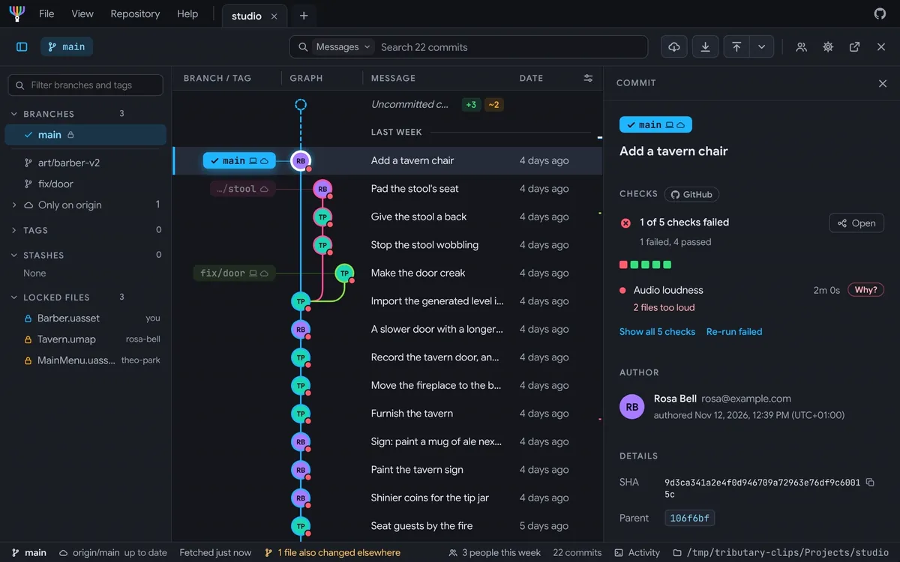
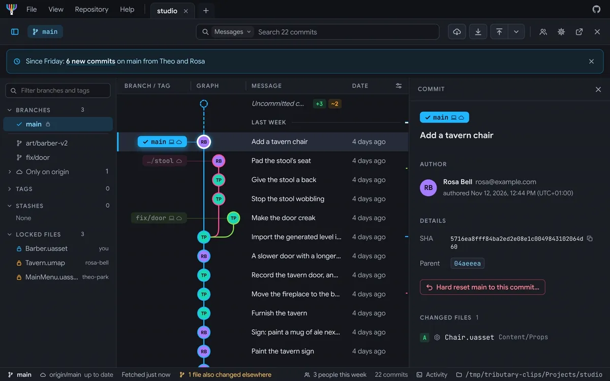

See why a check failed without leaving Tributary, and what arrived while you were away.

## New

- **Why a check failed:** a failed check says **Why?**, in a commit's details and in a pull request's checks. Click it, or a failed job in the checks graph, to see the job's steps with the failed one marked, and the end of its log, scrolled to where it failed, with the errors in red. **Copy log** copies it, **Open on GitHub** opens the job's page, and **Re-run job** runs just that job again. It works with GitHub Actions and GitLab. On GitHub, you need to be signed in to see a log.

  

- **Since you were last here:** come back to a repository, and a line above the list says what arrived on main while you were away: how many new commits and who wrote them, the pull requests merged, and which of your locked files someone else changed. Your own commits aren't counted, and it stays one line however much arrived. Nothing moves until you click: the count goes to where you left off, which is also marked beside the scrollbar, and × puts the line away.

  

## Fixes

- **Pointing at a mark beside the scrollbar** no longer also opens the preview of the commit under the pointer, over the mark's card.

<!-- release page only: the update window stops here -->

## Installing

- **macOS:** the `.dmg`, one app for Apple Silicon and Intel. Open it and drag Tributary to Applications.
- **Windows:** the `_x64-setup.exe`, or the `_arm64-setup.exe` for Windows on ARM (like a Snapdragon laptop). Agree to the terms and click Install, or choose **Custom install** to install it for everyone on the PC or in another folder.
- **Linux:** the `_amd64.AppImage`, or the `_aarch64.AppImage` for 64-bit ARM (like a Raspberry Pi 4 or 5 with a 64-bit system). Make it executable (`chmod +x Tributary_*.AppImage`, or in the file's Properties) and open it. It runs on most distributions from 2022 on, like Ubuntu 22.04 and newer. It's less tested than the Mac and Windows versions: reports and fixes are welcome.

Tributary needs [git](https://git-scm.com), and [Git LFS](https://git-lfs.com) for repositories that use it. After this, it updates itself.

The installers aren't code-signed yet, so the first launch on a Mac or Windows needs one extra step:

- **macOS, "Tributary Not Opened":** click **Done**, then open **System Settings → Privacy & Security**, scroll down to **Security** and click **Open Anyway** next to Tributary. Open it again and choose **Open Anyway**. On macOS 14 and earlier, you can instead Control-click the app in Applications and choose **Open**.
- **macOS, "is damaged" (or it still won't open):** move it to Applications and run `xattr -cr /Applications/Tributary.app` once in Terminal.
- **Windows:** if SmartScreen warns you, choose **More info → Run anyway**.

It's only needed once: the updates Tributary installs itself open straight away.
