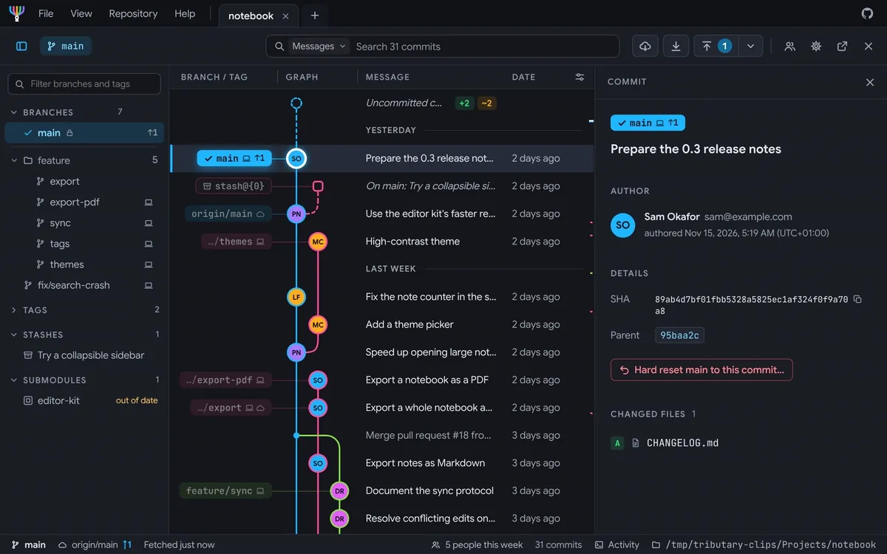
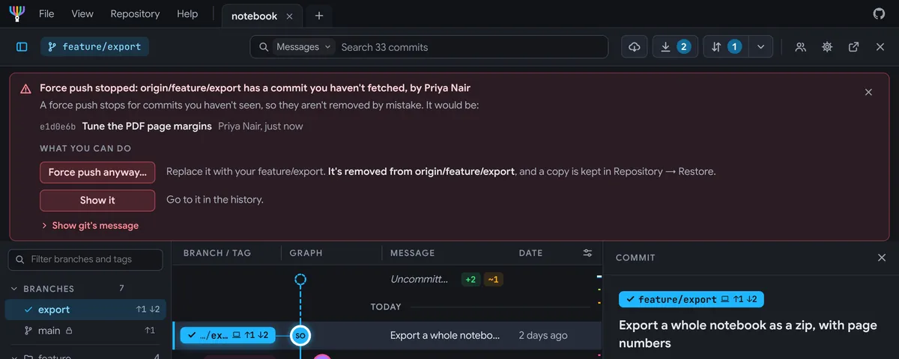

Errors that say what happened in plain words, a way past someone else's commits when force pushing, and fixes for Sync and force push.

## New

- **Errors in plain words:** when git stops something, the message above the list says what happened, and why, in a sentence. Under **What you can do**, each button has a line saying what it does. A push git refused because someone pushed first, for example, offers **Sync** (get their commits, then push yours on top; nothing is lost) and **Force push…** (replace them). git's own message is still there, under **Show git's message**, with **Copy**. It covers the errors git gives most often: refused pushes, protected branches, files too big for GitHub, signing in, a host that can't be reached, changes in the way, and more.

  

- **Force push over someone else's commits:** a force push stops if someone pushed to the branch since you last fetched, so their work isn't removed by mistake. It now says how many commits are in the way, and whose, and lists them, with **Force push anyway…** and **Show them**. The force push dialog has a box for it too: **Also remove commits others pushed since you last fetched**. What a force push replaces is kept in **Repository → Restore**.

  

## Fixes

- **Sync's error showed for a moment, then went away**, as the repository reloaded after the fetch. An error now stays until you close it, or the next action runs.
- **Sync works when git is set to only fast-forward** (`pull.ff = only`). It stopped on every branch with commits on both sides; it now puts your commits on top of what arrived, then pushes them.
- **A force push shows its progress**, like any push: the dialog closes, and the progress bar counts the Git LFS files being uploaded, with **Cancel**.

<!-- release page only: the update window stops here -->

## Installing

- **macOS:** the `.dmg`, one app for Apple Silicon and Intel. Open it and drag Tributary to Applications.
- **Windows:** the `_x64-setup.exe`, or the `_arm64-setup.exe` for Windows on ARM (like a Snapdragon laptop). Agree to the terms and click Install, or choose **Custom install** to install it for everyone on the PC or in another folder.
- **Linux:** the `_amd64.AppImage`, or the `_aarch64.AppImage` for 64-bit ARM (like a Raspberry Pi 4 or 5 with a 64-bit system). Make it executable (`chmod +x Tributary_*.AppImage`, or in the file's Properties) and open it. It runs on most distributions from 2022 on, like Ubuntu 22.04 and newer. It's less tested than the Mac and Windows versions: reports and fixes are welcome.

Tributary needs [git](https://git-scm.com), and [Git LFS](https://git-lfs.com) for repositories that use it. After this, it updates itself.

The installers aren't code-signed yet, so the first launch on a Mac or Windows needs one extra step:

- **macOS, "Tributary Not Opened":** click **Done**, then open **System Settings → Privacy & Security**, scroll down to **Security** and click **Open Anyway** next to Tributary. Open it again and choose **Open Anyway**. On macOS 14 and earlier, you can instead Control-click the app in Applications and choose **Open**.
- **macOS, "is damaged" (or it still won't open):** move it to Applications and run `xattr -cr /Applications/Tributary.app` once in Terminal.
- **Windows:** if SmartScreen warns you, choose **More info → Run anyway**.

It's only needed once: the updates Tributary installs itself open straight away.
