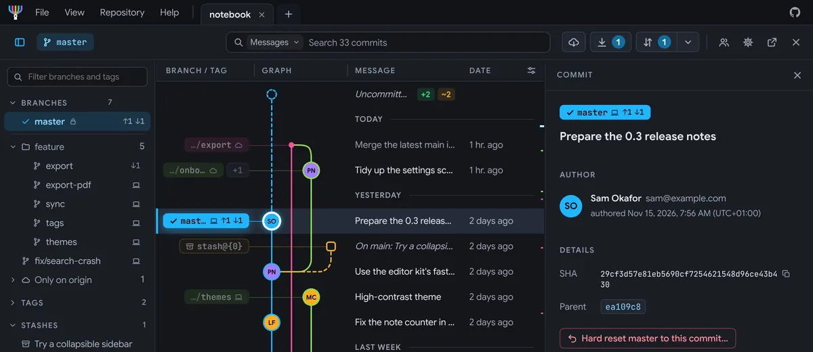

A branch renamed or deleted on the remote can be pointed at another one in a click, and the commit list shows one card on hover instead of two overlays.

## New

- **When a branch's remote branch is gone:** if it was renamed or deleted on the remote (master renamed to main, say), pulling or syncing it used to fail with git's "Your configuration specifies to merge with the ref… but no such ref was fetched". The message now says so plainly, and offers **Use origin/main**, the remote's main branch or one with the same name, as one click. **Choose another…** lists the remote's branches, the likely one first, with a box to rename your branch to match. **Push master** puts it back on the remote instead.

  

## Fixes

- **Pointing at a branch's label in the commit list showed two overlays**: the commit's card and the browser's tooltip. With the card on, it's the only one: what the label said (which branch, where it is, how far ahead or behind, double-click to check out) is at the card's top, and so is what the checks' dot, the pull request badge and the other labels say. The card also shows the author's email, and when the commit was made, when that isn't when it was written.

<!-- release page only: the update window stops here -->

## Installing

- **macOS:** the `.dmg`, one app for Apple Silicon and Intel. Open it and drag Tributary to Applications.
- **Windows:** the `_x64-setup.exe`, or the `_arm64-setup.exe` for Windows on ARM (like a Snapdragon laptop). Agree to the terms and click Install, or choose **Custom install** to install it for everyone on the PC or in another folder.
- **Linux:** the `_amd64.AppImage`, or the `_aarch64.AppImage` for 64-bit ARM (like a Raspberry Pi 4 or 5 with a 64-bit system). Make it executable (`chmod +x Tributary_*.AppImage`, or in the file's Properties) and open it. It runs on most distributions from 2022 on, like Ubuntu 22.04 and newer. It's less tested than the Mac and Windows versions: reports and fixes are welcome.

Tributary needs [git](https://git-scm.com), and [Git LFS](https://git-lfs.com) for repositories that use it. After this, it updates itself.

The installers aren't code-signed yet, so the first launch on a Mac or Windows needs one extra step:

- **macOS, "Tributary Not Opened":** click **Done**, then open **System Settings → Privacy & Security**, scroll down to **Security** and click **Open Anyway** next to Tributary. Open it again and choose **Open Anyway**. On macOS 14 and earlier, you can instead Control-click the app in Applications and choose **Open**.
- **macOS, "is damaged" (or it still won't open):** move it to Applications and run `xattr -cr /Applications/Tributary.app` once in Terminal.
- **Windows:** if SmartScreen warns you, choose **More info → Run anyway**.

It's only needed once: the updates Tributary installs itself open straight away.
