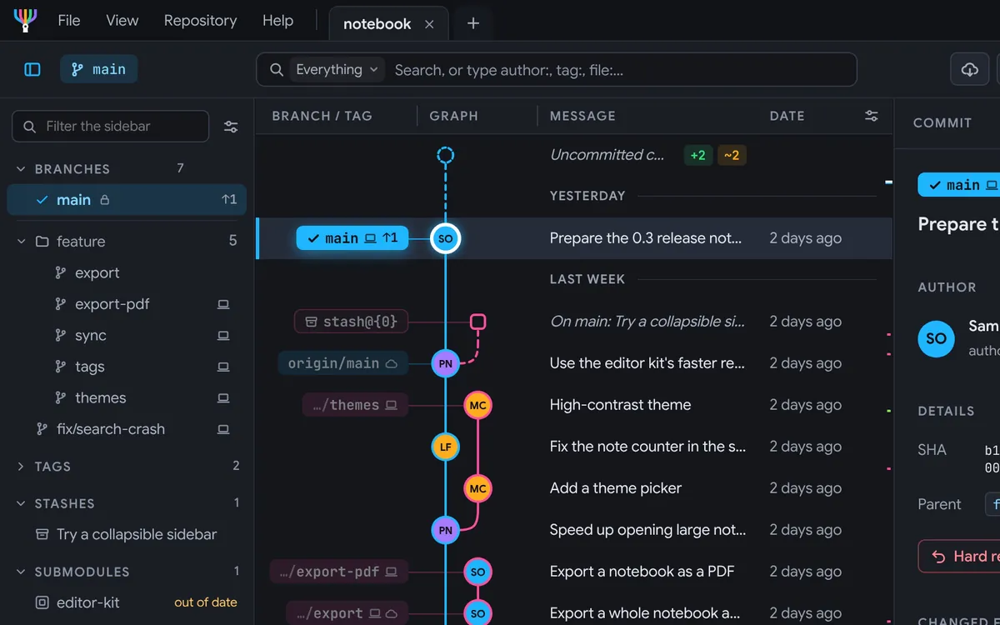
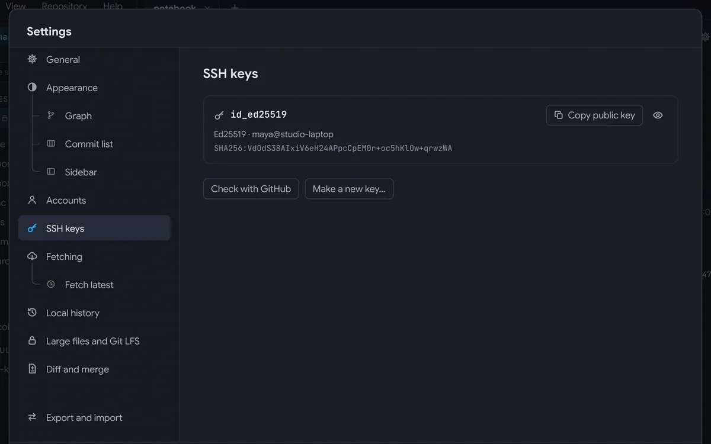
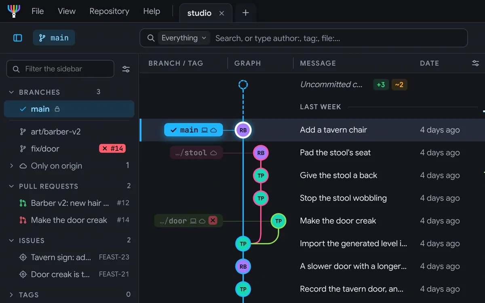
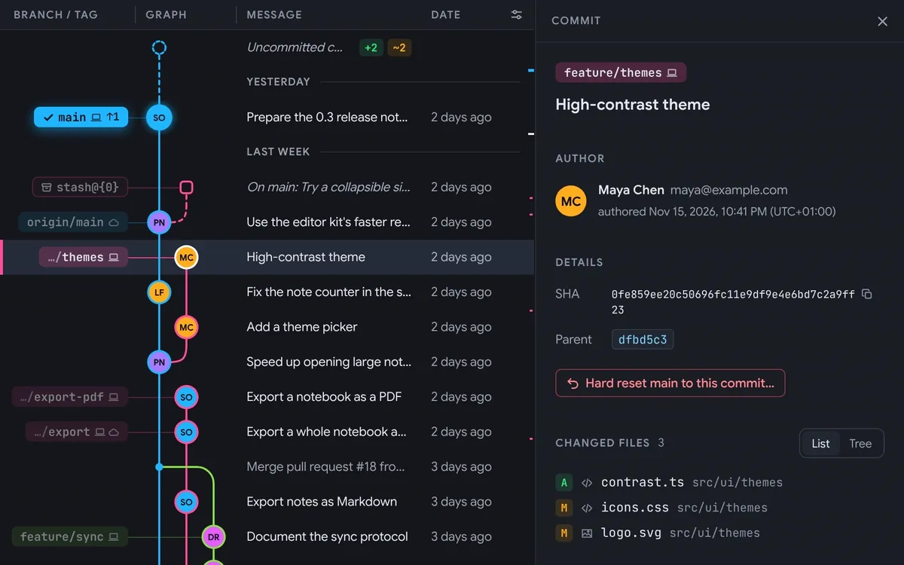

Search everything at once, your SSH keys in Settings, pull requests and issues in the sidebar, and pictures inside text files shown as pictures.

## New

- **Search everything:** the search box looks in commit messages (every line, not only the first), authors, branches and tags, commit ids, files and code at once, across the whole history. What it finds is listed by kind beside the history, in the sidebar's place, three of each with **Show all**. A commit found goes to it in the history; an author or a file lists their commits. To search one kind alone, choose it in the menu at the start of the search box, or type `message:`, `author:`, `branch:`, `tag:`, `hash:`, `file:` or `code:` before the words.

  

- **SSH keys in Settings:** **Settings → SSH keys** lists the keys in your `~/.ssh` folder with their kind and fingerprint. **Copy public key** copies the half that GitHub or GitLab asks for, and the eye button shows it. **Check with GitHub** says whether GitHub knows each key, and as which account. With no key yet, three steps make one (Ed25519, with a passphrase if you want one), add it to GitHub and check that it works. Only the public halves are read.

  

- **Pull requests and issues in the sidebar:** the sidebar lists the repository's open pull requests (or GitLab merge requests), each coloured by its checks, and a click opens one in the app. Under them are your open issues from the repository's issue tracker (Jira, Linear, GitHub or GitLab), and a click opens one in the browser. The button beside the sidebar's filter switches each of the sidebar's sections off or on, and so does **Settings → Appearance → Sidebar**. The filter finds pull requests and issues too.

  

- **Pictures inside text files:** a picture written into a text file (a base64 `data:` URL in CSS, HTML or JSON, or an image in a Jupyter notebook) is folded into a small label with its type and size, instead of a long line of letters. Under a line where a picture changed, its before and after are shown, with **Compare** for the full comparison. **SVG files** open as pictures, with the same ways to compare them as other pictures (side by side, swipe, onion skin and changed pixels), and **Picture | Text** shows their lines.

  

## Better

- **Bisect is easier to find,** in **Repository → History → Find What Broke (Bisect)…** and the command palette. It offers the tags before the checked-out commit as the one that worked, newest first, then the 30 commits before it. In a commit's right-click menu, bisecting has a target for an icon instead of a magnifying glass, which looked like search.
- **The search box starts where the history starts,** right above it, and follows the sidebar as it's resized or hidden. The menu of kinds in it is as wide as the kind chosen.

## Fixes

- **Git LFS installed with Homebrew or Nix wasn't found on a Mac** when Tributary was opened from the Finder or the Dock, and hooks couldn't find the programs they run. Tributary now finds programs where a terminal would: it asks your login shell for its `PATH`, and also looks where Nix, Homebrew and MacPorts put them.
- **Searching while a pull request was open** (or a commit's checks, the team view or a file's changes) searched the history behind it, out of sight. A search now closes what's over the history, so its matches can be seen.
- **A push stopped by a pre-push hook left out what the hook printed,** the part that says what to fix. It's now in the error, including lines like "Tests: 3 failed", which used to be dropped as if they were git's progress counts.
- **Esc didn't always close a right-click menu on a Mac.** It now does, wherever the focus is.

<!-- release page only: the update window stops here -->

## Installing

- **macOS:** the `.dmg`, one app for Apple Silicon and Intel. Open it and drag Tributary to Applications.
- **Windows:** the `_x64-setup.exe`, or the `_arm64-setup.exe` for Windows on ARM (like a Snapdragon laptop). Agree to the terms and click Install, or choose **Custom install** to install it for everyone on the PC or in another folder.
- **Linux:** the `_amd64.AppImage`, or the `_aarch64.AppImage` for 64-bit ARM (like a Raspberry Pi 4 or 5 with a 64-bit system). Make it executable (`chmod +x Tributary_*.AppImage`, or in the file's Properties) and open it. It runs on most distributions from 2022 on, like Ubuntu 22.04 and newer. It's less tested than the Mac and Windows versions: reports and fixes are welcome.

Tributary needs [git](https://git-scm.com), and [Git LFS](https://git-lfs.com) for repositories that use it. After this, it updates itself.

The installers aren't code-signed yet, so the first launch on a Mac or Windows needs one extra step:

- **macOS, "Tributary Not Opened":** click **Done**, then open **System Settings → Privacy & Security**, scroll down to **Security** and click **Open Anyway** next to Tributary. Open it again and choose **Open Anyway**. On macOS 14 and earlier, you can instead Control-click the app in Applications and choose **Open**.
- **macOS, "is damaged" (or it still won't open):** move it to Applications and run `xattr -cr /Applications/Tributary.app` once in Terminal.
- **Windows:** if SmartScreen warns you, choose **More info → Run anyway**.

It's only needed once: the updates Tributary installs itself open straight away.
