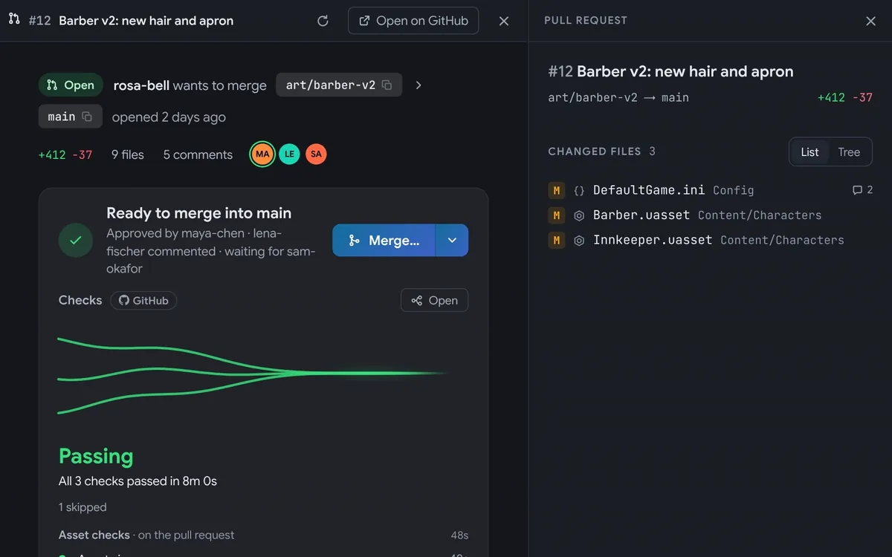
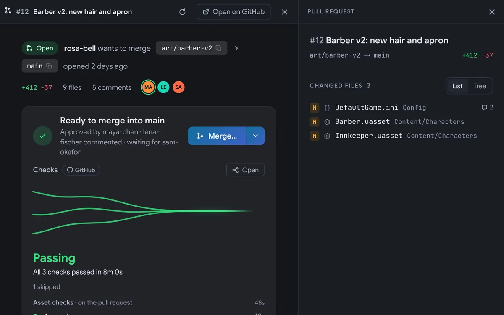

A pull request's files in the app: beside it, their changes over it with its review comments at their lines, and from a fork too.

## New

- **A pull request's files:** while a pull request is open, the details panel beside it lists the files it changes, as a list or a tree, with a filter for a long list. Click one to see its changes over the pull request, with the way back to it at the start of their header (**Esc** goes back too), and **[** and **]** step through its files. If its commits aren't in your repository yet, **Fetch its commits** brings them from GitHub or GitLab, even when its branch is on someone's fork. **See its changes** is gone from the pull request's buttons: its files are beside it now.

  

- **Review comments:** in a pull request's file's changes, each review thread is under the line it's on, with its replies and **Reply**. The number beside the line hides the thread and shows it again. Comments on lines that have changed since they were written are above the changes, with the lines they were about. In the list of files, a file with comments says how many.

  

## Fixes

- **Esc with a commit's changes open under a pull request closed both.** It now closes only the one on top, and a second **Esc** closes the other.
- **The "Owned by" and "Git LFS" chips** above a file's changes had their words a little low. They're in the middle now, as the other chips' are.

<!-- release page only: the update window stops here -->

## Installing

- **macOS:** the `.dmg`, one app for Apple Silicon and Intel. Open it and drag Tributary to Applications.
- **Windows:** the `_x64-setup.exe`, or the `_arm64-setup.exe` for Windows on ARM (like a Snapdragon laptop). Agree to the terms and click Install, or choose **Custom install** to install it for everyone on the PC or in another folder.
- **Linux:** the `_amd64.AppImage`, or the `_aarch64.AppImage` for 64-bit ARM (like a Raspberry Pi 4 or 5 with a 64-bit system). Make it executable (`chmod +x Tributary_*.AppImage`, or in the file's Properties) and open it. It runs on most distributions from 2022 on, like Ubuntu 22.04 and newer. It's less tested than the Mac and Windows versions: reports and fixes are welcome.

Tributary needs [git](https://git-scm.com), and [Git LFS](https://git-lfs.com) for repositories that use it. After this, it updates itself.

The installers aren't code-signed yet, so the first launch on a Mac or Windows needs one extra step:

- **macOS, "Tributary Not Opened":** click **Done**, then open **System Settings → Privacy & Security**, scroll down to **Security** and click **Open Anyway** next to Tributary. Open it again and choose **Open Anyway**. On macOS 14 and earlier, you can instead Control-click the app in Applications and choose **Open**.
- **macOS, "is damaged" (or it still won't open):** move it to Applications and run `xattr -cr /Applications/Tributary.app` once in Terminal.
- **Windows:** if SmartScreen warns you, choose **More info → Run anyway**.

It's only needed once: the updates Tributary installs itself open straight away.
