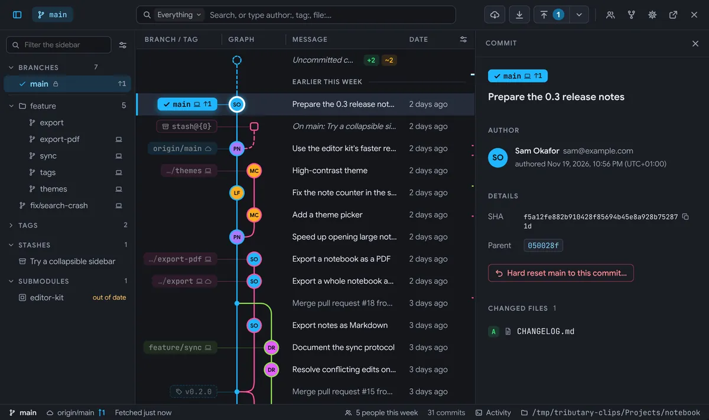

Your forks on GitHub, kept in step with the repositories they came from, and a new logo.

## New

- **Your forks:** turn on Settings → Accounts → Forks → **Your forks**, and a Forks button in the toolbar opens your forks on GitHub, with the window to themselves. Each says how far behind the repository it was forked from it is, and which of its commits are its own; click one to see what it would get. **Sync** brings the new commits into the fork on GitHub, as its **Sync fork** button there does, so nothing is downloaded, and **Sync 3 behind** syncs them all. A fork's **Auto** switch keeps it in sync by itself while Tributary is open, every hour or every day. If a fork's own changes clash with the original's, Tributary leaves it for you and says so.

  

## Better

- **A new logo:** a branch joining the main line, as a merged branch does in the history. The app's icon, the start screen, the loading animation and the website have it.

## Fixes

- **On Windows, searching for Tributary found nothing,** because the setup didn't put it in the Start menu. Updating to this version adds it there, and Windows search finds it.
- **On Linux, cloning from the AppImage failed** on some systems, with an error about libraries, and fetching and pushing could too. Git now runs as it would outside the AppImage.
- **On KDE, a window asked for your GitHub details** when Tributary started, even with nothing set up. Tributary's own checks in the background never ask for a password now; only signing in does.

<!-- release page only: the update window stops here -->

## Installing

- **macOS:** the `.dmg`, one app for Apple Silicon and Intel. Open it and drag Tributary to Applications.
- **Windows:** the `_x64-setup.exe`, or the `_arm64-setup.exe` for Windows on ARM (like a Snapdragon laptop). Agree to the terms and click Install, or choose **Custom install** to install it for everyone on the PC or in another folder.
- **Linux:** the `_amd64.AppImage`, or the `_aarch64.AppImage` for 64-bit ARM (like a Raspberry Pi 4 or 5 with a 64-bit system). Make it executable (`chmod +x Tributary_*.AppImage`, or in the file's Properties) and open it. It runs on most distributions from 2022 on, like Ubuntu 22.04 and newer. It's less tested than the Mac and Windows versions: reports and fixes are welcome.

Tributary needs [git](https://git-scm.com), and [Git LFS](https://git-lfs.com) for repositories that use it. After this, it updates itself.

The installers aren't code-signed yet, so the first launch on a Mac or Windows needs one extra step:

- **macOS, "Tributary Not Opened":** click **Done**, then open **System Settings → Privacy & Security**, scroll down to **Security** and click **Open Anyway** next to Tributary. Open it again and choose **Open Anyway**. On macOS 14 and earlier, you can instead Control-click the app in Applications and choose **Open**.
- **macOS, "is damaged" (or it still won't open):** move it to Applications and run `xattr -cr /Applications/Tributary.app` once in Terminal.
- **Windows:** if SmartScreen warns you, choose **More info → Run anyway**.

It's only needed once: the updates Tributary installs itself open straight away.
