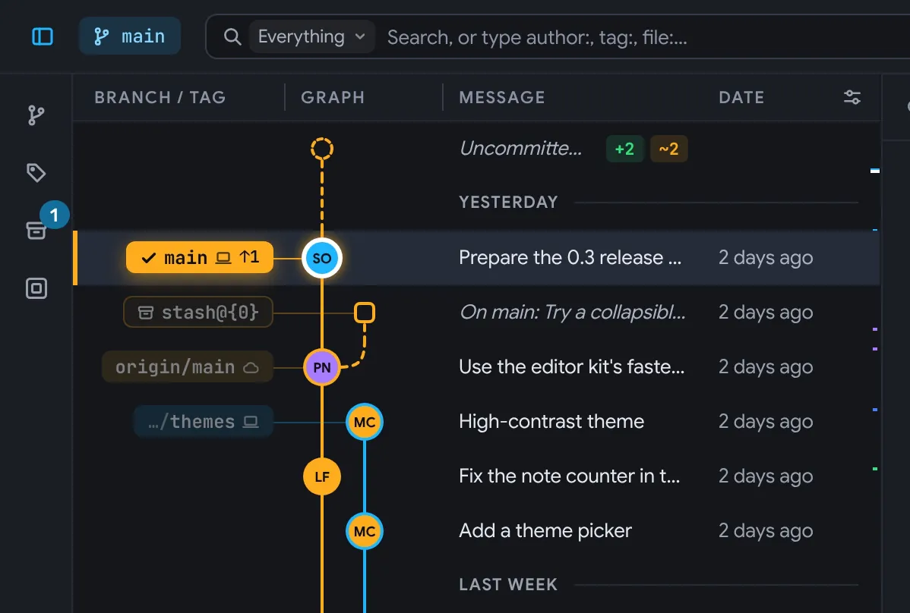

Colour your branches your way: each in a colour of its own, or by the kind of branch it is.

## New

- **Branch colours, two ways:** each branch in a colour of its own, never the one of the branch beside it, or each kind of branch in its colour (features, fixes, releases and the rest, from the branch's name). Either way, main keeps a colour no other branch takes, amber to start with, so a branch started from main never looks like it. Choose in Settings → Appearance → Graph, where two pictures show your colours as you change them, or from the View panel. The colours, the kinds and which branches count as main are all yours to change.

  

## Better

- **A branch has one colour everywhere:** its lines and dots, its labels, the marks beside the scrollbar, the details panel, and its glow when you point at its label.
- **A branch's whole name in the details panel**, when the panel is wide enough for it.
- **Checks say what happened:** a run whose jobs all passed, but one GitHub stopped (when it had no machine free to run it, say), shows as cancelled, not failed, and the job says why. One that ran out of time says so, and counts as failed.

<!-- release page only: the update window stops here -->

## Installing

- **macOS:** the `.dmg`, one app for Apple Silicon and Intel. Open it and drag Tributary to Applications.
- **Windows:** the `_x64-setup.exe`, or the `_arm64-setup.exe` for Windows on ARM (like a Snapdragon laptop). Agree to the terms and click Install, or choose **Custom install** to install it for everyone on the PC or in another folder.
- **Linux:** the `_amd64.AppImage`, or the `_aarch64.AppImage` for 64-bit ARM (like a Raspberry Pi 4 or 5 with a 64-bit system). Make it executable (`chmod +x Tributary_*.AppImage`, or in the file's Properties) and open it. It runs on most distributions from 2022 on, like Ubuntu 22.04 and newer. It's less tested than the Mac and Windows versions: reports and fixes are welcome.

Tributary needs [git](https://git-scm.com), and [Git LFS](https://git-lfs.com) for repositories that use it. After this, it updates itself.

The installers aren't code-signed yet, so the first launch on a Mac or Windows needs one extra step:

- **macOS, "Tributary Not Opened":** click **Done**, then open **System Settings → Privacy & Security**, scroll down to **Security** and click **Open Anyway** next to Tributary. Open it again and choose **Open Anyway**. On macOS 14 and earlier, you can instead Control-click the app in Applications and choose **Open**.
- **macOS, "is damaged" (or it still won't open):** move it to Applications and run `xattr -cr /Applications/Tributary.app` once in Terminal.
- **Windows:** if SmartScreen warns you, choose **More info → Run anyway**.

It's only needed once: the updates Tributary installs itself open straight away.

To check that a file you downloaded is the one GitHub built from Tributary's code, with the [GitHub CLI](https://cli.github.com): `gh attestation verify Tributary_0.18.0_x64-setup.exe -R shikoko/tributary` (with the name of the file you downloaded).
