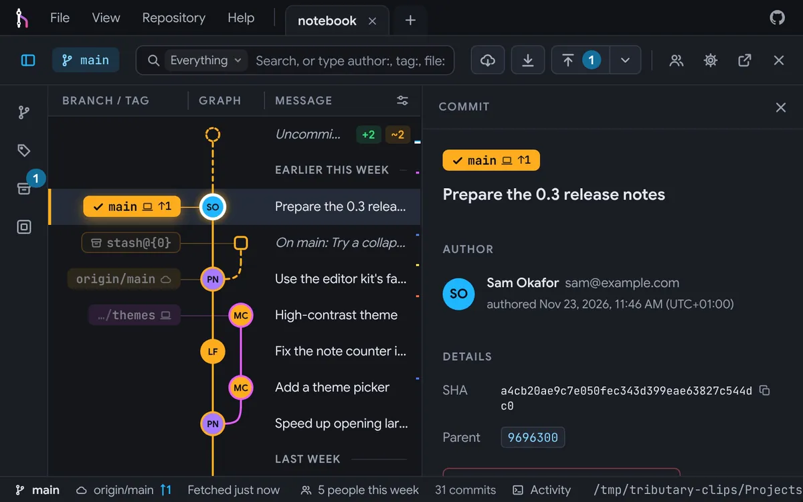
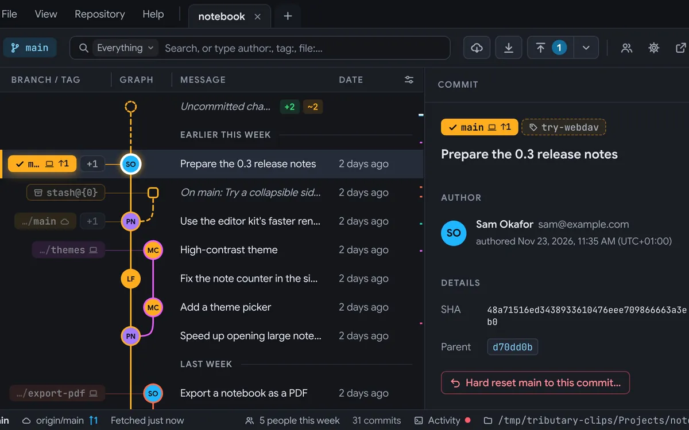

Open folders in Tributary from File Explorer, choose which tags to push, and stage a new folder's files one by one.

## New

- **Open in Tributary, from File Explorer:** on Windows, right-click a folder, or the empty space in an open one, and choose **Open in Tributary**. On Windows 11 it's under **Show more options**. The folder opens in a tab of its own, in the Tributary that's already running if there is one. A folder that isn't a repository yet offers to make it one.

  
- **Push tags:** pushing a branch doesn't push its tags. **Push tags…**, in the menu beside Push, asks the remote which tags it has and lists the ones it's missing. Those on commits it already has, usually releases, are ticked. One on a commit only you have isn't, as a pushed tag is hard to take back.

  

## Better

- **The files in a new folder:** a folder you've just made lists each file in it, so you can look at, stage or discard them one at a time, or the whole folder at once. A folder of more than 1,000 new files, like build output that should be ignored, stays one line.
- **Starting Tributary while it's open** brings its window to the front, instead of opening a second one.
- **On Windows, Settings → Apps names Tributary's publisher**, Bogdan Roatis, instead of "github".

<!-- release page only: the update window stops here -->

## Installing

- **macOS:** the `.dmg`, one app for Apple Silicon and Intel. Open it and drag Tributary to Applications.
- **Windows:** the `_x64-setup.exe`, or the `_arm64-setup.exe` for Windows on ARM (like a Snapdragon laptop). Agree to the terms and click Install, or choose **Custom install** to install it for everyone on the PC or in another folder.
- **Linux:** the `_amd64.AppImage`, or the `_aarch64.AppImage` for 64-bit ARM (like a Raspberry Pi 4 or 5 with a 64-bit system). Make it executable (`chmod +x Tributary_*.AppImage`, or in the file's Properties) and open it. It runs on most distributions from 2022 on, like Ubuntu 22.04 and newer. It's less tested than the Mac and Windows versions: reports and fixes are welcome.

Tributary needs [git](https://git-scm.com), and [Git LFS](https://git-lfs.com) for repositories that use it. After this, it updates itself.

The installers aren't code-signed yet, so the first launch on a Mac or Windows needs one extra step:

- **macOS, "Tributary Not Opened":** click **Done**, then open **System Settings → Privacy & Security**, scroll down to **Security** and click **Open Anyway** next to Tributary. Open it again and choose **Open Anyway**. On macOS 14 and earlier, you can instead Control-click the app in Applications and choose **Open**.
- **macOS, "is damaged" (or it still won't open):** move it to Applications and run `xattr -cr /Applications/Tributary.app` once in Terminal.
- **Windows:** if SmartScreen warns you, choose **More info → Run anyway**.

It's only needed once: the updates Tributary installs itself open straight away.

To check that a file you downloaded is the one GitHub built from Tributary's code, with the [GitHub CLI](https://cli.github.com): `gh attestation verify Tributary_0.19.0_x64-setup.exe -R shikoko/tributary` (with the name of the file you downloaded).
