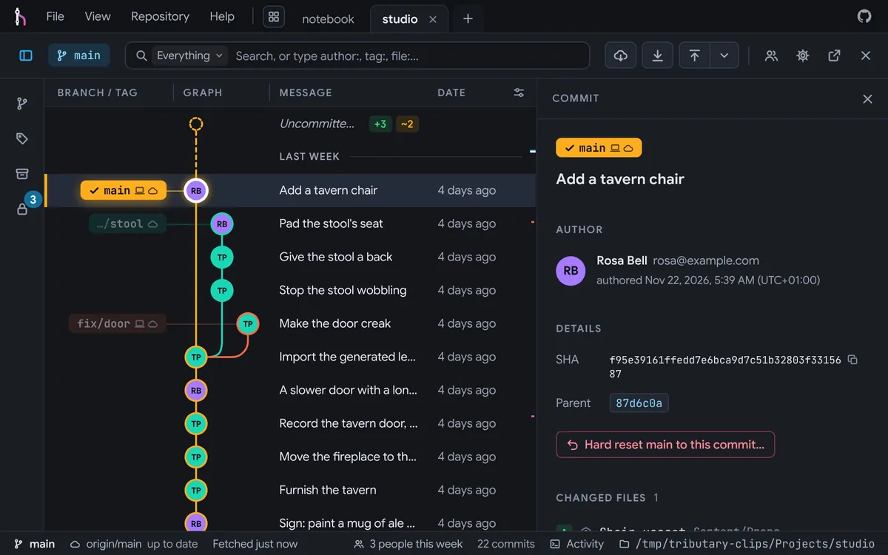
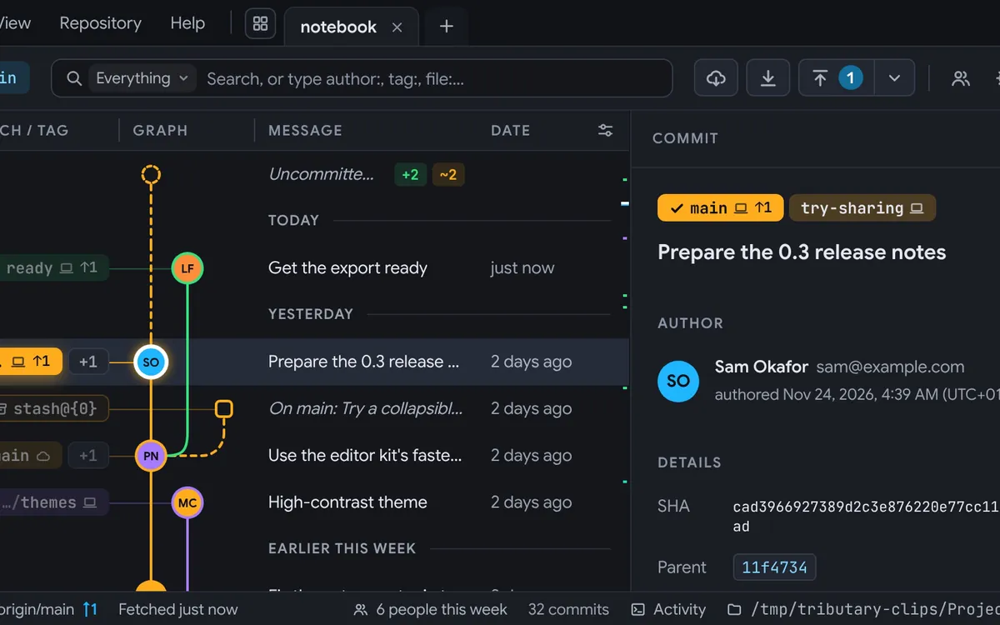
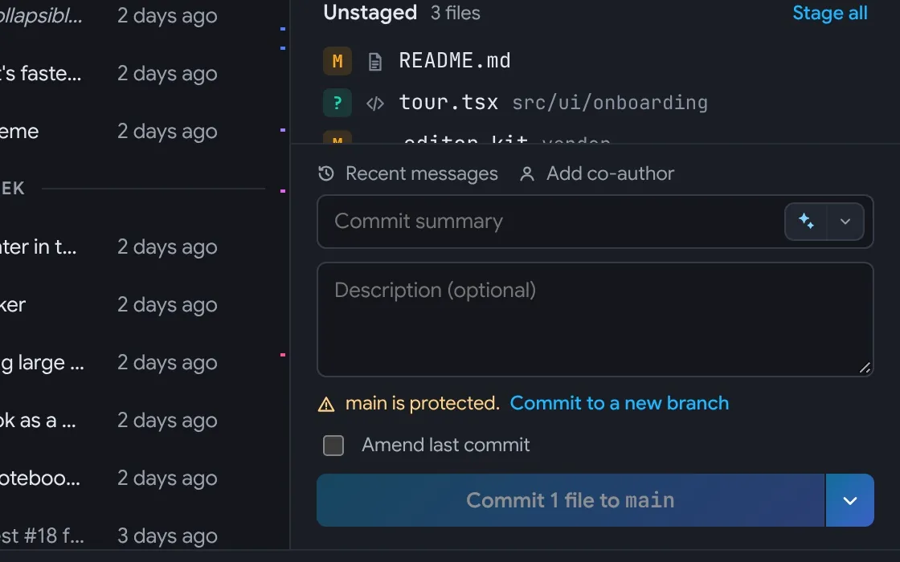

Workspaces for your open repositories, commit messages written with AI, and choosing which branches to push.

## New

- **Workspaces:** keep sets of tabs apart, like a game's repositories and its website's. The button at the start of the tab bar shows every open repository at a glance: its branch, its changes, what there is to pull or push, and when it was last fetched. Make a workspace from there, switch with it or with Ctrl+Alt+1, 2… (⌥⌘1, 2… on a Mac), and fetch every repository in one at once. Repositories you open join the workspace you're in.

  
- **Push branches:** **Push branches…**, in the menu beside Push, asks the remote what it has and lists your branches with commits it doesn't. Those it already has a copy of are ticked; one you've never pushed isn't, as pushing shares it with everyone. Push the ones you choose in one go. Moved to a new, empty repository, it offers every branch at once.

  
- **Commit messages written with AI:** turn it on in **Settings → AI**, choose Claude, OpenAI or Gemini with your own API key, or a model on your own computer (Ollama or LM Studio), and a sparkle in the commit summary writes the message from your staged changes: like your repository's recent messages, as a Conventional Commit, or as one line. Edit it, **Try again** or **Undo**. Nothing is sent until you click it, and then only your staged changes, straight to the provider you chose. Your key stays in your system's keychain.

  

## Better

- **Moving a repository to a new address keeps every branch:** changing a remote's address asks first when the new address is missing branches the old one had, and copies them across with the tags, even ones with no commits of their own, like a main whose work is all on develop.
- **A fetch keeps work the remote no longer has:** when a branch is gone from the remote but its commits aren't on any branch here, the fetch keeps it aside and asks whether to keep it as a branch or let it go (Restore keeps a copy for 30 days). Fetching after a remote was pointed at a new address outside Tributary keeps every branch the new one lacks.
- **Menus and panels join the button that opened them,** so it's clear where each came from: File, View, Repository and Help, a tab's menu, the workspace button and the view options.
- **Picking a new workspace's colour** no longer makes the workspace before you've chosen.
- **On Windows, Settings' drop-downs** have their words in the middle.
- **Adding a remote** keeps both its name and address as you type them.

<!-- release page only: the update window stops here -->

## Installing

- **macOS:** the `.dmg`, one app for Apple Silicon and Intel. Open it and drag Tributary to Applications.
- **Windows:** the `_x64-setup.exe`, or the `_arm64-setup.exe` for Windows on ARM (like a Snapdragon laptop). Agree to the terms and click Install, or choose **Custom install** to install it for everyone on the PC or in another folder.
- **Linux:** the `_amd64.AppImage`, or the `_aarch64.AppImage` for 64-bit ARM (like a Raspberry Pi 4 or 5 with a 64-bit system). Make it executable (`chmod +x Tributary_*.AppImage`, or in the file's Properties) and open it. It runs on most distributions from 2022 on, like Ubuntu 22.04 and newer. It's less tested than the Mac and Windows versions: reports and fixes are welcome.

Tributary needs [git](https://git-scm.com), and [Git LFS](https://git-lfs.com) for repositories that use it. After this, it updates itself.

The installers aren't code-signed yet, so the first launch on a Mac or Windows needs one extra step:

- **macOS, "Tributary Not Opened":** click **Done**, then open **System Settings → Privacy & Security**, scroll down to **Security** and click **Open Anyway** next to Tributary. Open it again and choose **Open Anyway**. On macOS 14 and earlier, you can instead Control-click the app in Applications and choose **Open**.
- **macOS, "is damaged" (or it still won't open):** move it to Applications and run `xattr -cr /Applications/Tributary.app` once in Terminal.
- **Windows:** if SmartScreen warns you, choose **More info → Run anyway**.

It's only needed once: the updates Tributary installs itself open straight away.

To check that a file you downloaded is the one GitHub built from Tributary's code, with the [GitHub CLI](https://cli.github.com): `gh attestation verify Tributary_0.20.0_x64-setup.exe -R shikoko/tributary` (with the name of the file you downloaded).
