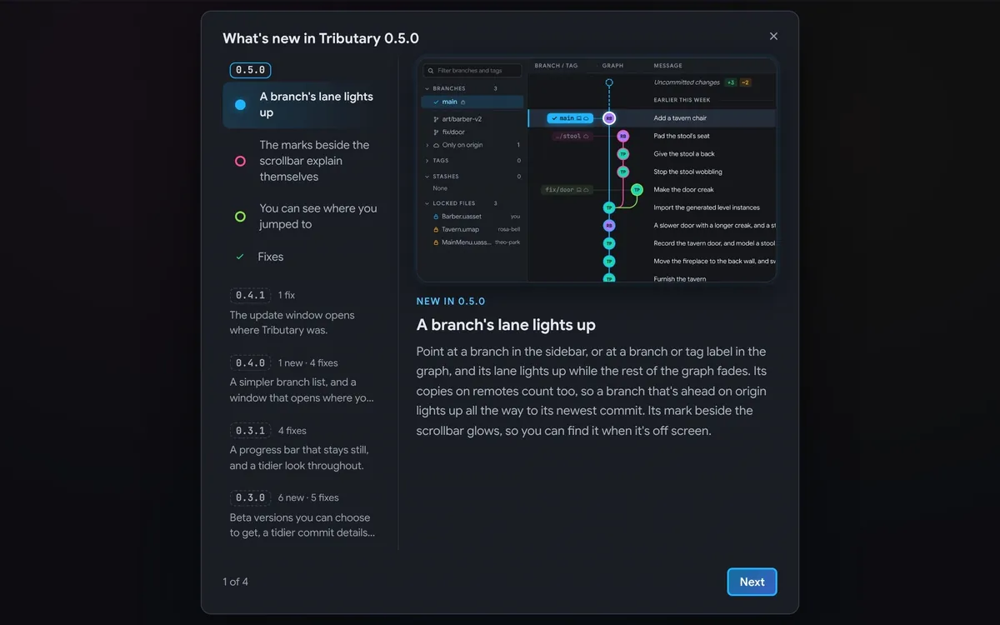

What's New shows each new thing working, with every version's notes beside it, and a few things line up better.

## New

- **What's New shows each new thing working:** after an update, and from About Tributary, What's New goes through the version's notes one new thing at a time, each with a short moving picture of it, then the fixes together.

  

- **Every version's notes, in What's New:** the list beside the new things goes back through every version, newest first, with how much each brought and what it was about. Choose one to read it.

  

## Fixes

- **A branch's lit lane goes under other commits:** where it reaches the commit it was branched from, a merge, or the selected commit, it no longer covers them.
- **A merged pull request says Merged** in a commit's details, and its state lines up with its Show button.
- **Words in chips sit in the middle on Windows,** like the Beta label in About Tributary.
- **Reopen tabs on launch is in Settings → General,** with the other settings, instead of the Help menu.

<!-- release page only: the update window stops here -->

## Installing

- **macOS:** the `.dmg`, one app for Apple Silicon and Intel. Open it and drag Tributary to Applications.
- **Windows:** the `-setup.exe` (64-bit): agree to the terms and click Install, or choose **Custom install** to install it for everyone on the PC or in another folder.

Tributary needs [git](https://git-scm.com), and [Git LFS](https://git-lfs.com) for repositories that use it. After this, it updates itself.

The installers aren't code-signed yet, so the first launch needs one extra step:

- **macOS, "Tributary Not Opened":** click **Done**, then open **System Settings → Privacy & Security**, scroll down to **Security** and click **Open Anyway** next to Tributary. Open it again and choose **Open Anyway**. On macOS 14 and earlier, you can instead Control-click the app in Applications and choose **Open**.
- **macOS, "is damaged" (or it still won't open):** move it to Applications and run `xattr -cr /Applications/Tributary.app` once in Terminal.
- **Windows:** if SmartScreen warns you, choose **More info → Run anyway**.

It's only needed once: the updates Tributary installs itself open straight away.
