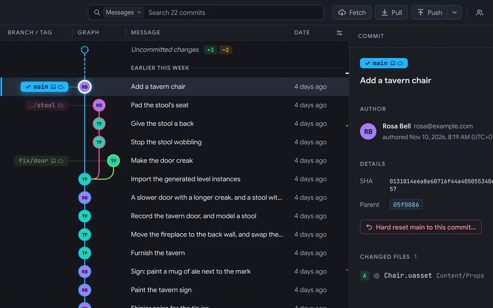
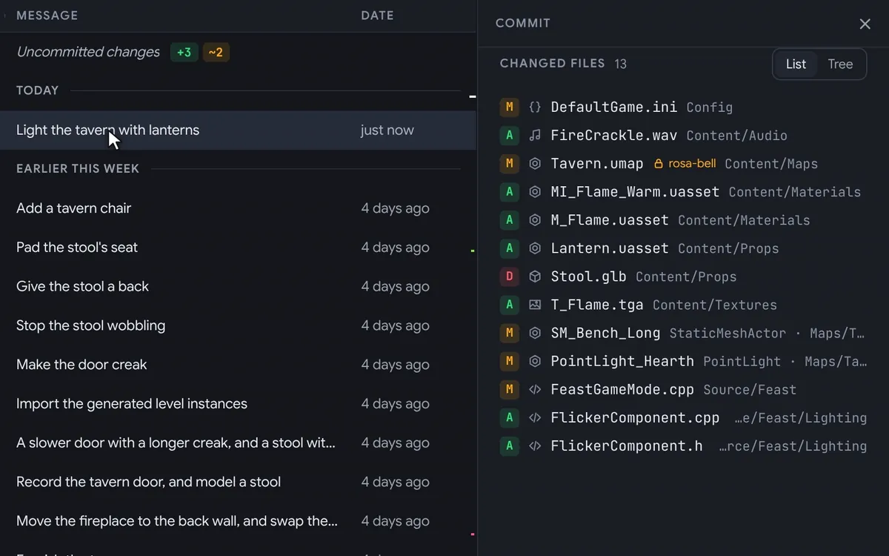

A View panel in the toolbar changes how the window looks in a click, and a commit's changed files can be shown as a tree of their folders.

## New

- **The View panel:** the View button at the end of the toolbar opens the things you change most, each seen straight away: the theme and accent colour, how the graph draws its commits and lines, the commit list's columns and rows, day separators and the branches sidebar. The rest is a click away, in Settings → Appearance.

  

- **A commit's changed files as a tree:** the List and Tree switch beside Changed files shows them in their folders, one inside another. Each folder says how many of its files were added, changed and deleted, and closes with a click. Folders with nothing else in them share a row, like Source/Feast. Tributary remembers which you chose.

  

## Better

- **Tributary on GitHub:** the GitHub mark at the end of the tab bar opens Tributary's page on GitHub.

## Fixes

- **Pull request numbers sit in the middle of their badges on Windows at 100%,** where they were a pixel low.
- **Words on buttons sit in the middle at 100% to 150%,** like Show beside a pull request in a merge commit's details. They were a pixel or two high.

<!-- release page only: the update window stops here -->

## Installing

- **macOS:** the `.dmg`, one app for Apple Silicon and Intel. Open it and drag Tributary to Applications.
- **Windows:** the `-setup.exe` (64-bit): agree to the terms and click Install, or choose **Custom install** to install it for everyone on the PC or in another folder.

Tributary needs [git](https://git-scm.com), and [Git LFS](https://git-lfs.com) for repositories that use it. After this, it updates itself.

The installers aren't code-signed yet, so the first launch needs one extra step:

- **macOS, "Tributary Not Opened":** click **Done**, then open **System Settings → Privacy & Security**, scroll down to **Security** and click **Open Anyway** next to Tributary. Open it again and choose **Open Anyway**. On macOS 14 and earlier, you can instead Control-click the app in Applications and choose **Open**.
- **macOS, "is damaged" (or it still won't open):** move it to Applications and run `xattr -cr /Applications/Tributary.app` once in Terminal.
- **Windows:** if SmartScreen warns you, choose **More info → Run anyway**.

It's only needed once: the updates Tributary installs itself open straight away.
