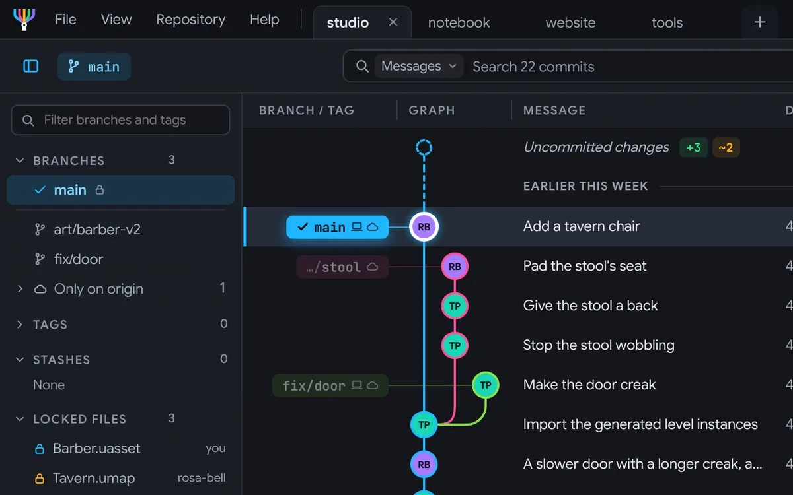
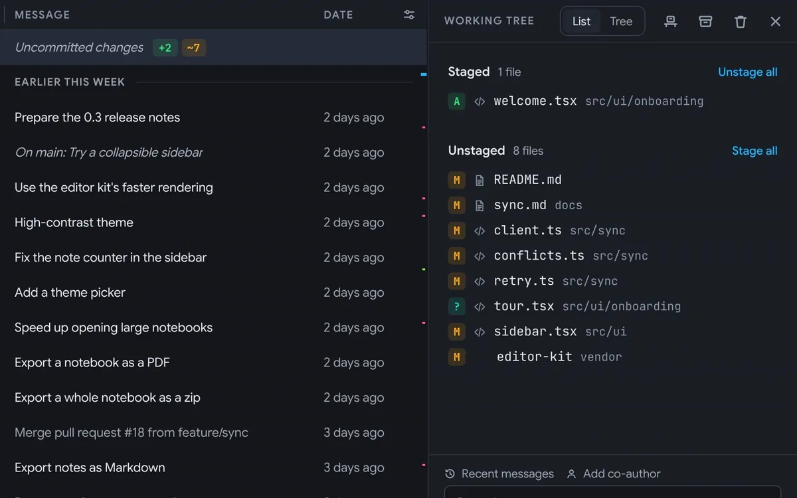

Tabs go where you drag them, uncommitted changes can be shown in their folders, and Tributary comes to Linux.

## New

- **Drag tabs into another order:** drag a tab along the tab bar, as in a browser, and the others slide aside to make room for it. Press Escape while dragging to put it back. From the keyboard, Ctrl+Shift+Page Up and Page Down move the open tab, and a tab's menu has Move Tab Left and Move Tab Right. Tributary keeps the order when it reopens your tabs.

  

- **Uncommitted changes as a tree:** the List and Tree switch is in the Working tree panel too, and shows your changes in their folders. Point at a folder for a button that stages or unstages everything changed in it. Tributary remembers which you chose, here and for a commit's changed files alike.

  

## Better

- **Tributary on Linux:** each release has an AppImage beside the Mac and Windows installers, and it updates itself as they do.
- **An open pull request in its branch's commit details:** the commit at the tip of a branch with an open pull request lists it, with Show to open it in Tributary, as a merge commit lists its merged one.
- **The View panel from the keyboard:** Ctrl+Shift+O (⇧⌘O on a Mac) opens and closes it, and it's in the View menu (View Options…) and the command palette too.
- **Your own colours for checks:** Settings → Appearance → Checks' colours changes running, passed and failed, for pull requests' badges, the dots on commits and the checks themselves. Pick another when one is too close to a branch's colour, like an amber branch whose pull request's checks are running.
- **Checks on dots in the View panel,** under how commits are drawn. In Settings → Appearance, each way the graph's lines can bend is a picture now, as the looks of checks on dots are.

## Fixes

- **Words sit in the middle of buttons and chips at 100% display scale too,** where some were still a pixel high or low: Show beside a pull request and Re-run failed in a commit's checks on Windows, the banners' buttons and the team view's "you" tag. Some controls are a pixel taller for it.
- **The glow around the checks' river comes in gently,** in the river's own colours, where it used to start with an edge you could see.
- **A repository's name and email for commits keep what you type** in its settings. They could go back to what was set before while it was still being read.
- **Closing the View panel on a Mac puts the keyboard focus back on the View button,** where it used to be lost.
- **A pull request's badge on a branch label opens it at the bottom of the commit list too,** where pressing it could select the commit instead.

<!-- release page only: the update window stops here -->

## Installing

- **macOS:** the `.dmg`, one app for Apple Silicon and Intel. Open it and drag Tributary to Applications.
- **Windows:** the `-setup.exe` (64-bit): agree to the terms and click Install, or choose **Custom install** to install it for everyone on the PC or in another folder.
- **Linux:** the `.AppImage` (64-bit). Make it executable (`chmod +x Tributary_*.AppImage`, or in the file's Properties) and open it. It runs on most distributions from 2022 on, like Ubuntu 22.04 and newer. It's less tested than the Mac and Windows versions: reports and fixes are welcome.

Tributary needs [git](https://git-scm.com), and [Git LFS](https://git-lfs.com) for repositories that use it. After this, it updates itself.

The installers aren't code-signed yet, so the first launch on a Mac or Windows needs one extra step:

- **macOS, "Tributary Not Opened":** click **Done**, then open **System Settings → Privacy & Security**, scroll down to **Security** and click **Open Anyway** next to Tributary. Open it again and choose **Open Anyway**. On macOS 14 and earlier, you can instead Control-click the app in Applications and choose **Open**.
- **macOS, "is damaged" (or it still won't open):** move it to Applications and run `xattr -cr /Applications/Tributary.app` once in Terminal.
- **Windows:** if SmartScreen warns you, choose **More info → Run anyway**.

It's only needed once: the updates Tributary installs itself open straight away.
