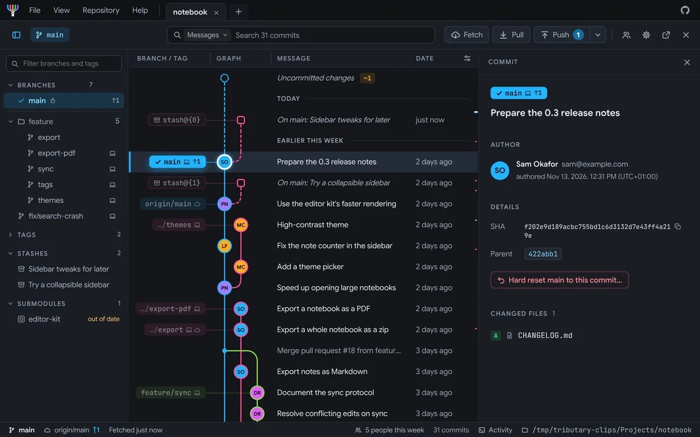
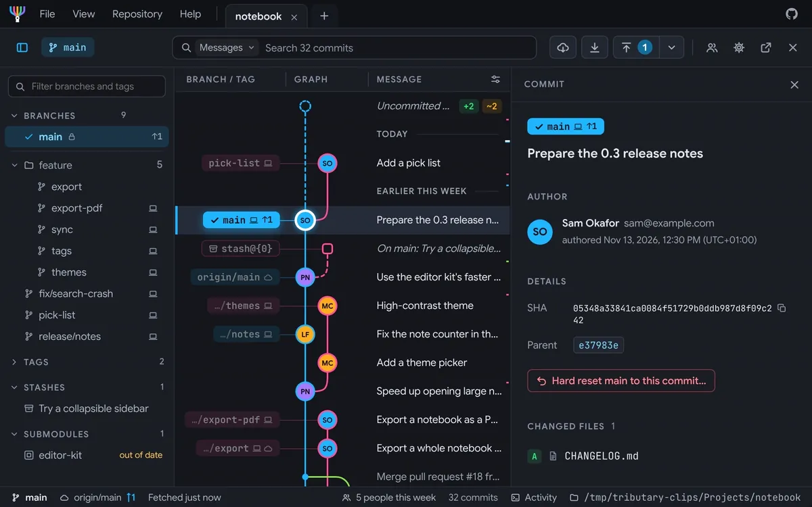

A commit's checks drawn run by run, Sync for a branch with new commits on both sides, and a commit dragged onto a branch to cherry-pick it.

## New

- **A commit's checks, run by run:** click a commit's CI dot in the list (or **Open** beside its checks in its details, or **Show checks** in its menu) to see each GitHub Actions run as GitHub draws it. Its jobs are in columns by which waits for which, joined by lines that take the colour of how the job before went and flow while it runs. A matrix job's jobs share one box, a running job shows the step it's on, and jobs still waiting for others are there too. A run wider than the view scrolls sideways, with an arrow on the side there's more of. On GitLab, the pipeline's stages are the columns.

  

- **Sync:** when your branch and the branch it tracks both have new commits, Push becomes Sync, which pulls and then pushes in one go. It stops without pushing if the pull has conflicts. If a commit you had pushed was amended or rebased since, it asks before force pushing instead.

  

- **Drag a commit onto a branch to cherry-pick it:** drop a commit on a local branch's label, in the graph or the sidebar, and it's copied onto that branch. A branch that isn't checked out stays that way, and your files aren't touched. Undo takes it back off.

  

- **Go to Commit:** Ctrl+G (⌘G on a Mac), or View → Go to Commit…, goes to a commit by its id, a branch, a tag or a day, loading older history to reach it.

  

- **Reopen closed tabs:** Ctrl+Shift+R (⇧⌘R on a Mac), File → Reopen Closed Tab or a tab's menu brings back the last tab you closed, in its old place in the tab bar.

  

## Better

- **A commit's pull request and checks, built alike:** in a commit's details, the pull request and the checks each have a section, with the site (GitHub or GitLab) in a chip beside its heading. The pull request says where it stands, in the words its own view uses, like "Merged into main" or "Can't be merged yet: changes were asked for", with its number, title and who opened it under that, and Show. The checks say how they went, like "1 of 7 checks failed", or "13 of 20 checks passed" when the rest were cancelled or skipped, with a pip for each check in its colour, and Open. The failed and running ones are listed under them.
- **A pull request's checks start with a summary:** in a pull request's view, its checks start as a commit's do, with a title naming what needs looking at: the checks that failed, like "Audio loudness failed", else the ones still running, and once they've passed, how long they took. Under it are the counts and Open, which shows each run as a graph.
- **Pull request badges show their checks as an icon:** a spinner while they run, a tick when they pass and a cross when they fail, so the state shows even on a branch label of the same colour. On the commit list's labels the badge is the icon alone, so branch names keep their room. Settings → Appearance → Commit list → Pull request numbers shows the number there too.
- **Old branches in Prune branches:** the dialog can also offer branches with no commits for 3 months, 6 months or a year, each saying how long it has gone without one. They're left unticked unless they're merged.
- **Long lines wrap in a file's changes:** the wrap button beside the side-by-side button wraps them to the width of the changes, and Tributary remembers it for every file.
- **Discarding many files shows that it's working:** Discard all, and discarding chosen files or folders, show the progress strip with how many files go.
- **Spelling suggestions in commit messages:** right-click a word underlined as misspelt in a commit's summary or description, or in a pull request's description or comment, for the suggestions.
- **Tabs as wide as their names:** a tab you point at shows its close button over the end of its name, as in a browser, and the open tab always shows its close button.
- **Tributary on Windows on ARM and on ARM Linux:** each release has a setup for Windows on ARM and an AppImage for 64-bit ARM Linux too.

## Fixes

- **The keyboard shortcuts window fits in the app's window,** where it ran past the top and bottom of a short one. Its shortcuts are in groups down the side, each key a keycap of its own, with a search to find one by typing, and its list scrolls inside it. Dragging a commit onto a branch and clicking a commit's CI dot are in the list.
- **A menu item's shortcut reads on its highlight** in the dark theme, where it was too faint.
- **A pull request's checks fit a small window** with the sidebar and details open: the verdict goes under the river, where the streams ran under it, and each check in the list keeps its name.
- **Words sit in the middle of badges, branch labels and the toolbar's buttons at 150% and 200% display scale too,** where some were a screen pixel low, like a pull request's number in the sidebar.
- **The checked-out branch's label reads on two lane colours:** Vivid's pink and Soft's purple are a little darker, so the label's text is clear on them.

<!-- release page only: the update window stops here -->

## Installing

- **macOS:** the `.dmg`, one app for Apple Silicon and Intel. Open it and drag Tributary to Applications.
- **Windows:** the `_x64-setup.exe`, or the `_arm64-setup.exe` for Windows on ARM (like a Snapdragon laptop). Agree to the terms and click Install, or choose **Custom install** to install it for everyone on the PC or in another folder.
- **Linux:** the `_amd64.AppImage`, or the `_aarch64.AppImage` for 64-bit ARM (like a Raspberry Pi 4 or 5 with a 64-bit system). Make it executable (`chmod +x Tributary_*.AppImage`, or in the file's Properties) and open it. It runs on most distributions from 2022 on, like Ubuntu 22.04 and newer. It's less tested than the Mac and Windows versions: reports and fixes are welcome.

Tributary needs [git](https://git-scm.com), and [Git LFS](https://git-lfs.com) for repositories that use it. After this, it updates itself.

The installers aren't code-signed yet, so the first launch on a Mac or Windows needs one extra step:

- **macOS, "Tributary Not Opened":** click **Done**, then open **System Settings → Privacy & Security**, scroll down to **Security** and click **Open Anyway** next to Tributary. Open it again and choose **Open Anyway**. On macOS 14 and earlier, you can instead Control-click the app in Applications and choose **Open**.
- **macOS, "is damaged" (or it still won't open):** move it to Applications and run `xattr -cr /Applications/Tributary.app` once in Terminal.
- **Windows:** if SmartScreen warns you, choose **More info → Run anyway**.

It's only needed once: the updates Tributary installs itself open straight away.
