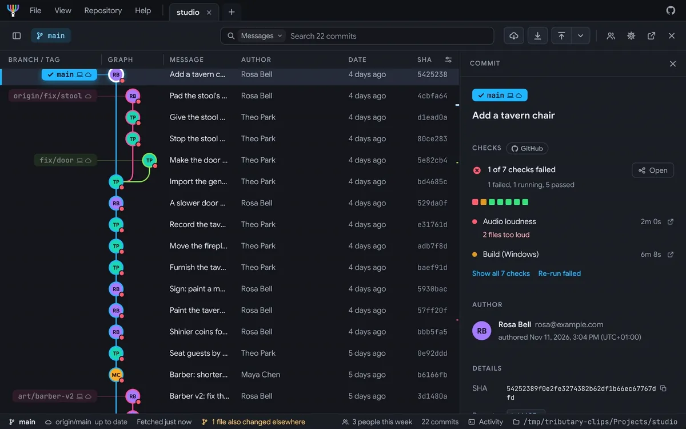
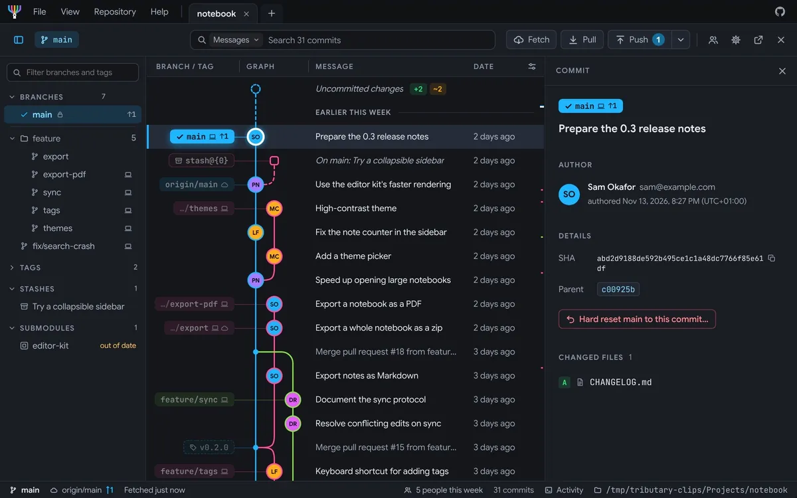
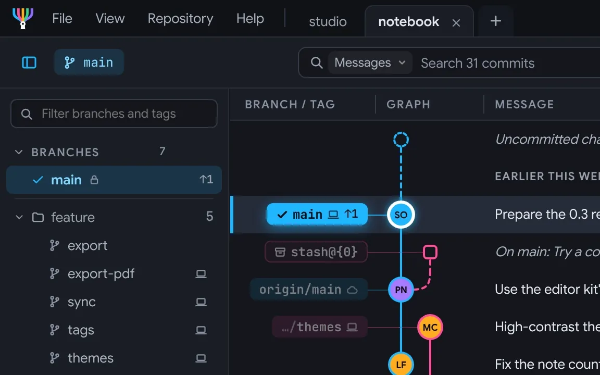

See a commit's checks as a graph, sync a branch in one click, and cherry-pick a commit by dragging it onto a branch.

## New

- **Checks as a graph:** click the coloured dot next to a commit (or **Open** beside its checks in the details panel) to see its GitHub Actions runs laid out the way GitHub draws them. Each job is a box, and lines show which job waits for which. The lines turn green or red as jobs pass or fail, and move while a job runs. Jobs that run on several platforms share one box, a running job shows the step it's on, and jobs that haven't started yet are there too. When a run is wider than the window, scroll sideways or click the arrow. On GitLab, you see the pipeline's stages.

  

- **Sync:** when both your branch and its copy on the server have new commits, the Push button becomes **Sync**. One click pulls their commits and then pushes yours. If the pull runs into conflicts, Sync stops before pushing. If you amended or rebased commits you had already pushed, it asks before force pushing.

  

- **Drag to cherry-pick:** drag a commit onto a branch's label, in the graph or in the sidebar, to copy it onto that branch. You stay on the branch you're on, and your files aren't touched. Undo takes it back off.

  

- **Go to a commit:** press Ctrl+G (⌘G on a Mac), or choose View → Go to Commit…, and type a commit's id, a branch, a tag or a date. Tributary scrolls to it, loading older history if it needs to.

  

- **Reopen closed tabs:** press Ctrl+Shift+R (⇧⌘R on a Mac), choose File → Reopen Closed Tab, or use any tab's menu to bring back the tab you closed last, in the same place in the tab bar.

  

## Better

- **Pull requests and checks look alike in a commit's details:** each gets its own section, marked GitHub or GitLab. The pull request says where it stands, like "Merged into main" or "Can't be merged yet: changes were asked for", with its number, title and author underneath. The checks say how they went, like "1 of 7 checks failed", with a small square for each check in its colour, and list the ones that failed or are still running.
- **A pull request's checks start with a summary:** the title names what needs your attention: the checks that failed, like "Audio loudness failed", or the ones still running, or how long they took once they've passed. Below it are the counts and **Open**, which shows each run as a graph.
- **Pull request badges show an icon:** a spinner while the checks run, a tick when they pass and a cross when they fail, so you can tell even when the badge is the same colour as the branch's label. On labels in the commit list, the badge is just the icon, leaving room for the branch's name. To show the number there too, turn on Settings → Appearance → Commit list → Pull request numbers.
- **Prune branches can include old branches:** as well as merged branches, it can offer branches with no new commits for 3 months, 6 months or a year, and says how long each has been quiet. They're only ticked if they're merged.
- **Wrap long lines in a file's changes:** the wrap button, next to the side-by-side button, fits long lines to the width of the changes. Tributary remembers your choice.
- **See progress when discarding many files:** Discard all, and discarding chosen files or folders, show a progress bar with the number of files.
- **Spelling suggestions:** right-click an underlined word in a commit message, or in a pull request's description or comment, to see suggestions.
- **Tabs as wide as their names:** point at a tab to see its close button over the end of its name, as in a browser. The current tab always shows it.
- **Windows on ARM and ARM Linux:** each release now has an installer for Windows on ARM and an AppImage for 64-bit ARM Linux.

## Fixes

- **The keyboard shortcuts window fits in small windows.** Shortcuts are in groups down the side, each key is shown on its own, and you can find one by typing. It now lists dragging a commit onto a branch and clicking a commit's coloured dot too.
- **Menu shortcuts are readable when highlighted** in the dark theme.
- **A pull request's checks fit small windows:** with the sidebar and details open, the status moves under the graph of checks instead of covering it, and each check keeps its name.
- **Text sits in the middle of badges, labels and toolbar buttons at 150% and 200% display scaling,** where some was a pixel too low.
- **The current branch's label is easier to read on two lane colours:** pink in Vivid and purple in Soft are slightly darker.

<!-- release page only: the update window stops here -->

## Installing

- **macOS:** the `.dmg`, one app for Apple Silicon and Intel. Open it and drag Tributary to Applications.
- **Windows:** the `_x64-setup.exe`, or the `_arm64-setup.exe` for Windows on ARM (like a Snapdragon laptop). Agree to the terms and click Install, or choose **Custom install** to install it for everyone on the PC or in another folder.
- **Linux:** the `_amd64.AppImage`, or the `_aarch64.AppImage` for 64-bit ARM (like a Raspberry Pi 4 or 5 with a 64-bit system). Make it executable (`chmod +x Tributary_*.AppImage`, or in the file's Properties) and open it. It runs on most distributions from 2022 on, like Ubuntu 22.04 and newer. It's less tested than the Mac and Windows versions: reports and fixes are welcome.

Tributary needs [git](https://git-scm.com), and [Git LFS](https://git-lfs.com) for repositories that use it. After this, it updates itself.

The installers aren't code-signed yet, so the first launch on a Mac or Windows needs one extra step:

- **macOS, "Tributary Not Opened":** click **Done**, then open **System Settings → Privacy & Security**, scroll down to **Security** and click **Open Anyway** next to Tributary. Open it again and choose **Open Anyway**. On macOS 14 and earlier, you can instead Control-click the app in Applications and choose **Open**.
- **macOS, "is damaged" (or it still won't open):** move it to Applications and run `xattr -cr /Applications/Tributary.app` once in Terminal.
- **Windows:** if SmartScreen warns you, choose **More info → Run anyway**.

It's only needed once: the updates Tributary installs itself open straight away.
